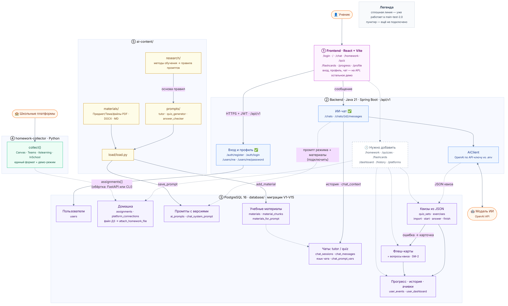
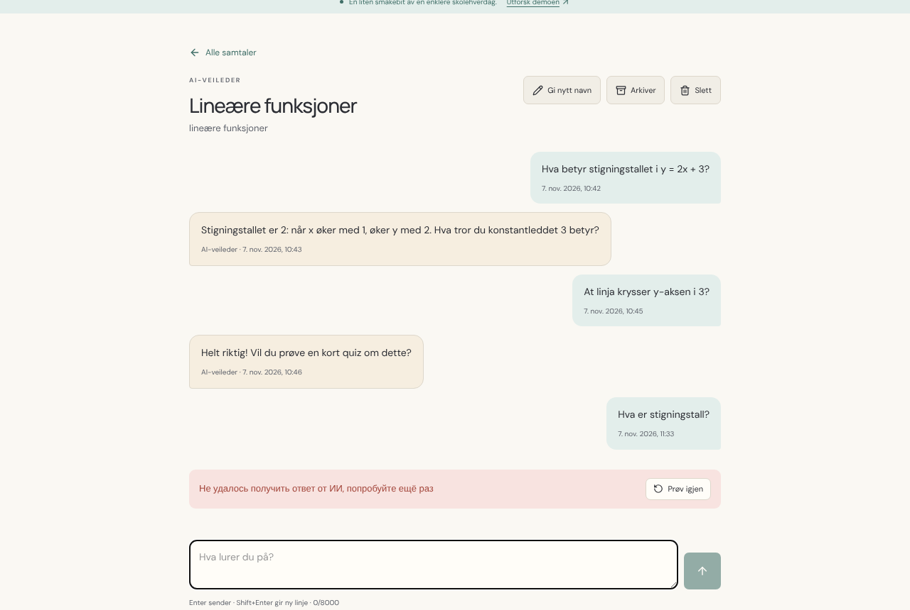

# main-test-2.0: проверка перед слиянием

`main-test-2.0` — тестовая сборка всего проекта, **main не тронут**. Собрана так:

| Что | Откуда | Новое по сравнению с 1.0 |
|---|---|---|
| база, сбор ДЗ, промпты, документация | `main-test-1.0` | — |
| `backend/`, `docs/API.md` | `JavaAPI-setup` (3 коммита) | страницы фронта в API.md, Groq как бесплатный ИИ в `.env.example`, исправлен пример 401 |
| `frontend/` | `Frontend-setup` (11 коммитов) | **вход, профиль и ИИ-чат работают на API бэкенда**, proxy Vite, 32 теста, CI на GitHub Actions, тёмная тема |

Конфликтов при слиянии не было. Как запустить: [docs/RUN.md](docs/RUN.md).
Все таблицы и сущности: [database/ENTITIES.md](database/ENTITIES.md).

## Что проверено (7 ноября 2026, 10:35)

| Часть | Как проверял | Результат |
|---|---|---|
| База | миграции V1–V15 + `seed.sql` на чистом PostgreSQL 16 | ✅ |
| Промпты | `ai-content/load/load.py` → `tutor`, `quiz_generator`, `answer_checker` версия 1 | ✅ |
| Сбор ДЗ | `pytest` в `homework-collector` | ✅ 6 из 6 |
| Фронтенд | `pnpm test` (контракт URL с API.md, клиент API, тема) | ✅ 32 из 32 |
| Фронтенд | `pnpm build` (tsc + vite) | ✅ |
| Бэкенд | `mvn package` с тестами | ✅ 3 из 3 |
| **Всё вместе в браузере** | Playwright: фронт (`pnpm dev`) → proxy → бэкенд → база | ✅ см. ниже |

Сценарий в браузере:

1. `/` без входа → редирект на `/login` ✅
2. вход `demo@lekseradar.no` / `demo1234` → `POST /api/v1/auth/login` 200 → дашборд `/` ✅
3. дашборд: `GET /users/me`, `GET /chats` 200, последний чат виден ✅
4. `/chat` → демо-чат «Lineære funksjoner» → `/chat/1`, история из базы ✅
5. новый вопрос → `POST /chats/1/messages` → 502 (ключа ИИ не было), на экране ошибка и «Prøv igjen» ✅
6. `/profile`, `/homework`, `/quiz`, `/flashcards`, `/progress` открываются без ошибок ✅

Не проверялось: настоящий ответ модели (нужен ключ Groq или OpenAI), вход на реальные платформы, деплой.

## Что исправлено с 1.0

- ✅ Фронтенд подключён к бэкенду: вход, регистрация, профиль, чат (был пункт 1 в 1.0).
- ✅ Proxy Vite добавлен, `allowedHosts` от v0.build убран.
- ✅ Появился CI (фронтенд) и 32 теста фронта.

## Слабые места

### 🔴 Мешает показать демо целиком

1. **Бэкенд не использует промпты из базы.** Чат берёт текст из `Prompts.java`, а не `chat_system_prompt()`:
   нет режимов `tutor` / `quiz`, выбора языка первым вопросом, файла ДЗ и материалов.
   В `Prompts.java` тьютор может дать готовое решение «после попыток» — по требованию никогда.
   → №2: `chat_system_prompt` + `chat_prompt_vars` + `materials_for_prompt`, метки `[[LANGUAGE=xx]]`
   ([ai-content/prompts/README.md](ai-content/prompts/README.md)). Проверено: в базе после теста у всех чатов `mode = tutor`, `language = NULL`.
2. **Нет эндпоинтов для ДЗ, квизов, карточек, дашборда, истории, материалов, платформ.**
   Функции в базе готовы, DTO расписаны в [ENTITIES.md](database/ENTITIES.md#новые-dto-для-api).
   Фронт на этих страницах показывает демо или «Kommer snart».
3. **`collect()` никто не вызывает.** ДЗ в базе только из `seed.sql`. Нужна обёртка (FastAPI или CLI) — №3.
4. **После `docker compose up` в базе нет промптов** — их грузит `load.py` отдельным шагом.

### 🟠 Безопасность и надёжность

5. **Нет защиты от перебора пароля** — неверные входы без задержки и блокировки.
6. **Токены платформ не шифруются** — колонка `credentials_enc` есть, кода AES-GCM нет.
7. **Повтор после 502 дублирует вопрос.** Вопрос сохраняется до ответа ИИ, «Prøv igjen» шлёт его ещё раз:
   после теста в демо-чате 3 вопроса ученика вместо 2. Нужен повтор без нового сообщения или идемпотентность.
8. **Демо-ученик с известным паролем** в `seed.sql` — для жюри можно, для продакшена нет.
9. **JWT 72 часа, отозвать нельзя.** Для хакатона нормально.
10. **CORS** только `localhost:5173`; на Vercel задать `CORS_ORIGINS` и `VITE_API_URL`.
11. **Миграции V8 и V11 правились после пуша** — у кого старая база: `docker compose down -v && docker compose up -d`.

### 🟡 Несостыковки

12. **Ошибки бэкенда по-русски, интерфейс по-норвежски.** На экране чата: «Не удалось получить ответ от ИИ…»
    рядом с «Prøv igjen». Нужны тексты ошибок на языке пользователя (или коды, а текст на фронте).
13. **Украинский язык.** Репетитор предлагает «Українська», а профиль принимает только `nb|nn|en|ru`
    (`PATCH /users/me {"locale":"uk"}` → 400); во фронте тип `Locale` такой же.
14. **`ChatResponse` без `mode`, `subject`, `language`** — фронт не может показать два вида чата.
15. **CI только для фронта.** Python, бэкенд и миграции базы в CI не проверяются.

### ⚪ Платформы

16. itslearning — клиент мобильного приложения (серая зона), Teams — нужна регистрация в Entra,
    InSchool — cookie-сессия истекает.

## Порядок до слияния в main

1. №2 — пункты 1, 2, 5, 7, 12, 13, 14; №3 — пункты 3, 4; №1 — экраны квиза и карточек на API, когда будут эндпоинты.
2. Повторить проверки из таблицы выше на следующем `main-test`.
3. Слить в main: PR #9 (база) → #2 (бэкенд) → #10 (фронт), или одним PR из тестовой ветки.
