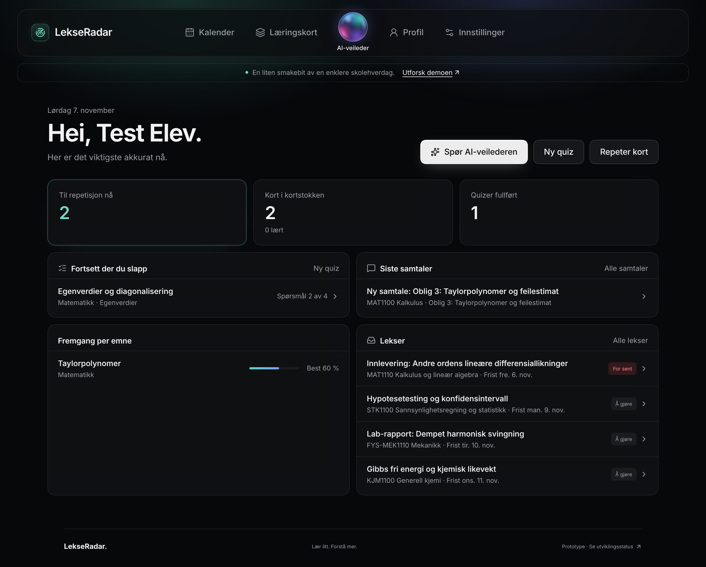
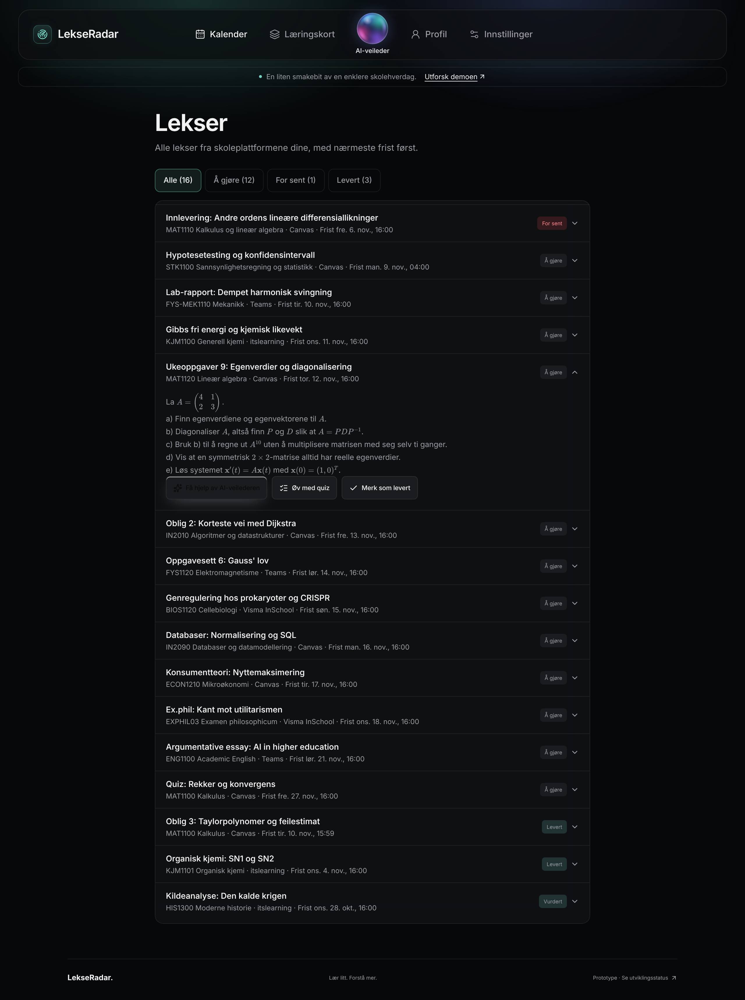

# main-test-3.0: проверка и доводка до MVP

`main-test-3.0` — тестовая сборка всего проекта, **main не тронут**. Собрана из `main-test-2.0` + свежих
`PythonAPI` (18 коммитов), `JavaAPI-setup` (28) и `Frontend-setup` (16). Затем в этой ветке исправлены найденные баги
и дописано то, без чего это не MVP. Каждый фикс — отдельный коммит.

Как запустить: [docs/RUN.md](docs/RUN.md). Тестовый ученик: `test@lekseradar.no` / `LekseRadar2026`,
[что у него есть](database/testdata/README.md). Все таблицы и эндпоинты: [database/ENTITIES.md](database/ENTITIES.md).

## Что проверено (7 ноября 2026, 16:30)

| Часть | Как проверял | Результат |
|---|---|---|
| База | миграции V1–V20 на чистом PostgreSQL 16 | ✅ |
| Docker | `docker compose --profile testdata up`: миграции → `content` (промпты) → `testdata` | ✅ |
| Промпты | `load.py` → `tutor`, `quiz_generator`, `answer_checker` | ✅ |
| Тестовые данные | `seed.sql` дважды подряд: 16 ДЗ, 5 квизов, 5 материалов, 2 карточки, без дублей | ✅ |
| Сбор ДЗ | `pytest` в `homework-collector` | ✅ 6 из 6 |
| Фронтенд | `pnpm test` / `pnpm build` | ✅ 93 из 93 / ✅ |
| Бэкенд | `mvn package` с тестами | ✅ 14 из 14 (+5 пропущено без базы) |
| Бэкенд + база | `RepositoriesIntegrationTest` с `TEST_DB_URL`, сущности проходят `validate` | ✅ 5 из 5 |
| **Всё вместе** | Playwright: фронт → proxy → бэкенд → база, ИИ — локальная заглушка с OpenAI API | ✅ см. ниже |

Сценарий в браузере (тестовый ученик):

1. Вход → главная: карточки к повторению, незаконченный квиз, последние чаты, **ближайшие ДЗ** с «For sent». ✅
2. `/homework`:
   - 16 заданий, фильтры «Alle / Å gjøre / For sent / Levert»;
   - сначала несданное по сроку;
   - задание раскрывается, формулы KaTeX рендерятся. ✅
3. «Få hjelp av AI-veilederen» → чат по заданию. Вопрос → ответ ИИ. В системном промпте текст задания и срок из базы. ✅
4. «Merk som levert» → статус «Levert», счётчики фильтров обновились, в истории «Leverte en lekse». ✅
5. `/quiz` Matematikk / Egenverdier / Avansert → готовый квиз из тестовых данных мгновенно, без ИИ → «Riktig!». ✅
6. `/flashcards`: 2 карточки из ошибок пройденного квиза. ✅
7. `/progress`: цифры, освоение по темам, активность по дням. `/history`: лента событий. ✅
8. Телефон 390 px: без горизонтальной прокрутки. Ни одного ответа API 4xx/5xx и ошибок в консоли. ✅

Не проверялось:
- настоящий ответ модели (нужен ключ Groq);
- вход на реальные школьные платформы;
- деплой.

## Анализ: что было найдено и что сделано

### Безопасность

| # | Проблема | Что сделано | Коммит |
|---|---|---|---|
| 1 | Перебор пароля без ограничений | 5 неверных входов на email за 15 минут → 429 до конца окна | `986ce75` |
| 2 | По времени ответа видно, есть ли такой email: bcrypt считался только для существующих | Для неизвестного email сверяется фиктивный хеш, время одинаковое | `a141127` |
| 3 | Любой ученик мог без ограничений дёргать ИИ и за минуты съесть дневной лимит ключа на всех | 30 запросов к ИИ за 10 минут на ученика (ответы в квизе — 120), 429 + `Retry-After` | `6c73c22` |
| 4 | Postgres с паролем `lekseradar` открыт на всех сетевых интерфейсах | Порт только на `127.0.0.1` | `7add20c` |

### Баги

| # | Проблема | Что сделано | Коммит |
|---|---|---|---|
| 5 | «Prøv igjen» после 502 сохранял вопрос ещё раз | Повтор берёт неотвеченный вопрос, а не сохраняет новый | `491087a` |
| 6 | Фронт в каждом чате спрашивал язык и отправлял «Русский» как вопрос; с V17 язык берётся с сайта | Выбор языка убран | `8c3239e` |
| 7 | 429 показывался как «Noe gikk galt» | Текст на языке интерфейса (nb/en/ru) | `08cd28e` |
| 8 | После `docker compose up` промптов нет, чат и квиз падают | Сервис `content` сам запускает `load.py` | `6a1f185` |
| 9 | Сданное и оценённое ДЗ стояло выше несделанного | Сначала просроченное и несданное по сроку | `2aa406e` |
| 10 | На прогрессе незаконченный квиз показывался как «Best 0 %» | Показываются только завершённые | `b50ad6c` |
| 11 | На главной «Lekser» дважды (заголовок и ссылка) | Ссылка «Alle lekser» | `f99a72d` |

### Чего не хватало для MVP

| # | Что | Коммит |
|---|---|---|
| 12 | API домашки: `GET /homework`, `GET/PATCH /homework/{id}` (статус overdue считается по сроку, чужое → 404) | `9ebd6ca` |
| 13 | API дашборда и истории: `GET /dashboard`, `GET /history` | `36d76d0` |
| 14 | Фронт: клиент и типы для них, тесты контракта #30–#34 | `5c3be8b` |
| 15 | Страница «Lekser»: фильтры, «сдано», чат с репетитором и квиз прямо из задания | `e0a662c` |
| 16 | Страницы «Fremgang» и «Historikk» на API вместо «Kommer snart» | `d3b5756` |
| 17 | Ближайшие ДЗ на главной | `c5db9a6` |
| 18 | Тестовые данные: 16 ДЗ университетского уровня по 10 предметам, 5 готовых квизов, 5 материалов, пройденный квиз | `c35b120` |
| 19 | Документация: API.md, URLS.md, RUN.md, README, ENTITIES | `ae2d74b`, `89b7955` и этот коммит |

## Что осталось

### 🔴 До настоящего запуска

1. **`collect()` никто не вызывает.** ДЗ с реальных платформ в базу не попадают, для демо есть тестовые данные.
   Нужна обёртка (FastAPI или CLI) и `POST /homework/sync` — №3 и №2.
2. **Нет API платформ** (`GET /platforms`, подключение и отключение), страница `/settings/platforms` — заглушка.
3. **Токены платформ не шифруются.** AES-GCM упомянут в `PlatformConnectionEntity`, кода нет. Нужно до пункта 2.

### 🟠 Надёжность

4. **Лимиты в памяти одного сервера.** При двух экземплярах бэкенда или после перезапуска счётчики свои и сбрасываются.
   Для хакатона хватает, дальше Redis или таблица.
5. **JWT 72 часа, отозвать нельзя.** Смена пароля старые токены не отключает.
6. **CORS** открыт только для `localhost:5173`. На Vercel нужно задать `CORS_ORIGINS` и `VITE_API_URL`.
7. **Тексты ошибок бэкенда по-русски.** Фронт подменяет их по коду ответа, поэтому интерфейс в порядке.
   Но у 400 с подробностями, например «нужен JSON-массив», детали на nb/en теряются.

### 🟡 Качество

8. **Материалы к ДЗ находятся редко.** Поиск фильтрует по предмету чата, а у ДЗ предмет — название курса
   («MAT1100 Kalkulus»), у материалов — «Matematikk». Плюс полнотекстовый поиск без синонимов.
9. **Ачивки и напоминания:** таблицы есть, API и отправки нет.
10. **CI только для фронта.** Бэкенд, Python и миграции в CI не проверяются.
11. **Изменения базы в этой ветке нет**, только `database/testdata` и `docker-compose.yml`. Для PR #9 их надо перенести в `PythonAPI`,
    Java-код — в `JavaAPI-setup`, фронт — в `Frontend-setup`.

### ⚪ Платформы

12. itslearning работает через клиент мобильного приложения (серая зона). Teams требует регистрации в Entra. Сессия InSchool на cookie истекает.

## Порядок до слияния в main

Подробный план по этапам: [PLAN-MVP.md](PLAN-MVP.md). Загрузить настоящие ДЗ из консоли уже можно: [docs/REAL-DATA.md](docs/REAL-DATA.md).

1. Перенести коммиты этой ветки по своим веткам (пункт 11) или слить одним PR из `main-test-3.0`.
2. №3 — пункт 1; №2 — пункты 1–3; №1 — страница платформ.
3. Проверить с настоящим ключом Groq: чат, квиз от ИИ, проверка текстовых ответов.
