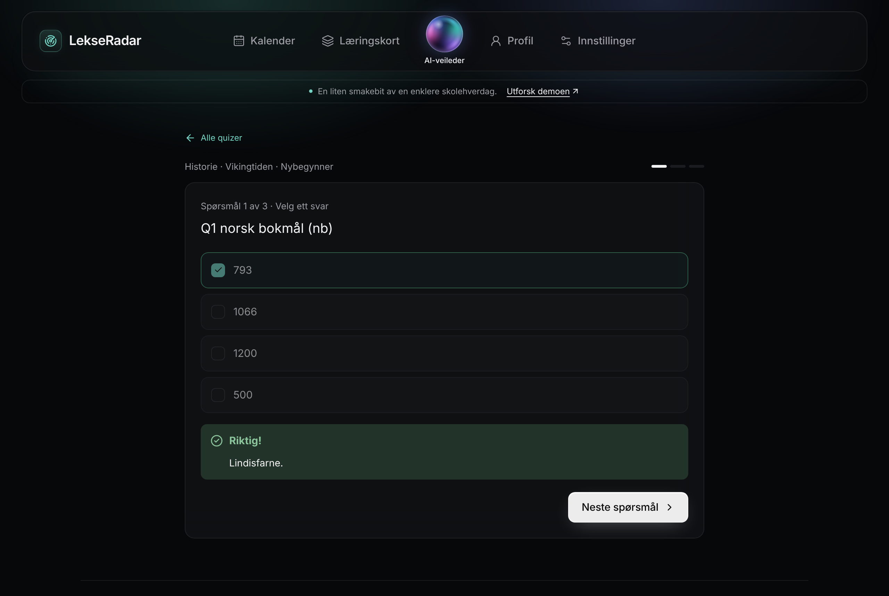

# main-test-3.0: проверка перед слиянием

`main-test-3.0` — тестовая сборка всего проекта, **main не тронут**. Собрана так:

| Что | Откуда | Новое по сравнению с 2.0 |
|---|---|---|
| основа | `main-test-2.0` | — |
| база, промпты, сбор ДЗ | `PythonAPI` (18 коммитов) | миграции V15–V20, без пробных данных, промпт тьютора, **язык квиза по коду (V20)**, исправления `load.py`, дашборда и ошибок квиза |
| `backend/` | `JavaAPI-setup` (28 коммитов) | сущности всех 20 таблиц (`…Entity`, `ddl-auto: validate`), промпты из базы, **квизы и флеш-карты на API**, ИИ-проверка текстовых ответов |
| `frontend/` | `Frontend-setup` (16 коммитов) | редизайн, язык интерфейса nb/en/ru, главная на настоящих данных, **квиз и карточки на API**, 83 теста |

При слиянии `PythonAPI` было три конфликта, только в документации:
- `database/README.md`: оставлено вступление тестовой ветки и добавлены строки V17–V20;
- `docs/ARCHITECTURE.md`: оставлен текст тестовой ветки;
- `database/ENTITIES.md`: взят из `PythonAPI` и обновлён под эту сборку.

`JavaAPI-setup` и `Frontend-setup` влились без конфликтов.
Как запустить: [docs/RUN.md](docs/RUN.md). Все таблицы, сущности и эндпоинты: [database/ENTITIES.md](database/ENTITIES.md).

## Что проверено (7 ноября 2026, 14:35)

| Часть | Как проверял | Результат |
|---|---|---|
| База | миграции V1–V20 на чистом PostgreSQL 16 (seed.sql больше нет) | ✅ |
| Промпты | `ai-content/load/load.py` → `tutor`, `quiz_generator`, `answer_checker` версия 1 | ✅ |
| Сбор ДЗ | `pytest` в `homework-collector` | ✅ 6 из 6 |
| Фронтенд | `pnpm test` | ✅ 83 из 83 |
| Фронтенд | `pnpm build` (tsc + vite) | ✅ |
| Бэкенд | `mvn package` с тестами | ✅ 12 из 12 (+5 пропущено без базы) |
| Бэкенд + база | `RepositoriesIntegrationTest` с `TEST_DB_URL` на V1–V20, сущности проходят `validate` | ✅ 5 из 5 |
| **Всё вместе** | фронт (`pnpm dev`) → proxy → бэкенд → база; ИИ — локальная заглушка с OpenAI-совместимым API | ✅ см. ниже |

Сценарий через API (через proxy фронта):

1. Регистрация двух учеников → 201. Повтор email в другом регистре → 409. Без токена → 401. ✅
2. Первому ставим язык сайта `PATCH /users/me {"locale":"uk"}` → 200 (в 2.0 было 400). ✅
3. Оба вызывают `POST /quizzes` (Historie / Vikingtiden). Создаются два набора, `uk` и `nb`, у каждого вопросы на своём языке. ✅
4. Повторный `POST /quizzes` у каждого возвращает свой готовый набор за 0,03 с, ИИ не вызывается. Это проверка фикса V20. ✅
5. Ответы:
   - single_choice → `correct`;
   - text `harald` при эталоне `Harald` → `correct` через `answer_checker`;
   - multiple_choice строкой `a` → 400 с понятным текстом (V19).

   ✅
6. `finish` → `score 66.67`, `POST /quiz-sets/{id}/flashcards` → 3 карточки, `GET /flashcards/due` и `/stats` дают 3 карточки. `GET /quizzes/progress` → 200. ✅
7. Чат-репетитор: системный промпт берётся из базы (`tutor`, около 4100 символов), язык подставлен с сайта. ✅

Сценарий в браузере (Playwright):

1. `/chat` без входа → `/login`. Вход → главная с настоящими данными: квиз «Fortsett der du slapp», последние чаты. ✅
2. `/quiz` → список «Mine quizer» → квиз → ответ «793» → «Riktig! Lindisfarne.» ✅
3. `/flashcards`, `/homework`, `/progress`, `/history`, `/settings/platforms`, `/profile`, `/settings`, `/status` открываются. Ошибок в консоли нет, запросов к API с кодом 4xx/5xx нет. ✅
4. Вопрос в чате → ответ ИИ на экране. ✅

Не проверялось: настоящий ответ модели (нужен ключ Groq), вход на реальные платформы, деплой.

## Что исправлено с 2.0

- ✅ Бэкенд берёт промпты из базы (`chat_system_prompt` + `chat_prompt_vars`), есть режимы `tutor` и `quiz` (был 🔴 1).
- ✅ Появились эндпоинты квизов и флеш-карт, фронт работает с ними без демо-данных (часть 🔴 2).
- ✅ `ChatResponse` отдаёт `mode`, `subject`, `language`, `assignmentId`, `quizSetId` (был 🟡 14).
- ✅ Профиль принимает `uk` (был 🟡 13).
- ✅ Пробных данных нет: `seed.sql` и демо-ученик удалены (был 🟠 8).
- ✅ Квиз сохраняется на языке ученика, а не всегда `nb`, и готовый квиз находится снова (V20).

## Слабые места

### 🔴 Мешает показать демо целиком

1. **Нет эндпоинтов ДЗ, платформ, дашборда, истории и материалов.** `GET /homework`, `/platforms`, `/dashboard`, `/history`, `/materials` → 404.
   Репозитории и DTO для них уже есть ([ENTITIES.md](database/ENTITIES.md#бэкенд-сущности-репозитории-и-эндпоинты-main-test-30)).
   На фронте `/homework`, `/progress`, `/history` показывают «Kommer snart».
2. **`collect()` никто не вызывает.** Пробных данных больше нет, поэтому ДЗ в базе нет совсем. Нужна обёртка (FastAPI или CLI) — №3.
3. **После `docker compose up` в базе нет промптов.** Без `load.py` чат и квиз падают с ошибкой «промпт не загружен».

### 🟠 Безопасность и надёжность

4. **Повтор после 502 дублирует вопрос.** Два раза «Prøv igjen» → в чате три одинаковых вопроса подряд, ответ только на последний.
5. **Нет защиты от перебора пароля.** 7 неверных входов подряд → 7 раз 401, без задержки и блокировки.
6. **Токены платформ не шифруются.** AES-GCM упомянут только в комментарии `PlatformConnectionEntity`, кода шифрования нет.
7. **JWT 72 часа, отозвать нельзя.** Для хакатона нормально.
8. **CORS** открыт только для `localhost:5173`. На Vercel нужно задать `CORS_ORIGINS` и `VITE_API_URL`.

### 🟡 Несостыковки

9. **Фронт спрашивает язык в каждом чате.** Под ответом тьютора всегда висит «Hvilket språk vil du lære på?»:
   - условие показа `!chat.language`, а с V17 язык берётся с сайта и `chat.language` остаётся пустым;
   - кнопка отправляет «Русский» как вопрос ученика;
   - утверждённый промпт тьютора язык не спрашивает и метку `[[LANGUAGE=xx]]` не ставит.

   → №1: убрать выбор языка или делать по нему `PATCH /users/me {"locale"}`.
10. **Ошибки бэкенда по-русски, интерфейс по-норвежски.** Пример: 502 «Не удалось получить ответ от ИИ…» у ученика с `nb`.
11. **CI только для фронта.** Python, бэкенд и миграции в CI не проверяются.

### ⚪ Платформы

12. itslearning работает через клиент мобильного приложения (серая зона). Teams требует регистрации в Entra. Сессия InSchool на cookie истекает.

## Порядок до слияния в main

1. Распределение по участникам:
   - №2: пункты 1, 4, 5, 6, 10;
   - №3: пункты 2 и 3 (промпты можно грузить при старте бэкенда);
   - №1: пункт 9 и экраны ДЗ, прогресса и истории, когда будут эндпоинты.
2. Повторить проверки из таблицы выше на `main-test-4.0`.
3. Слить в main: PR #9 (база) → #2 (бэкенд) → фронт, или одним PR из тестовой ветки.
