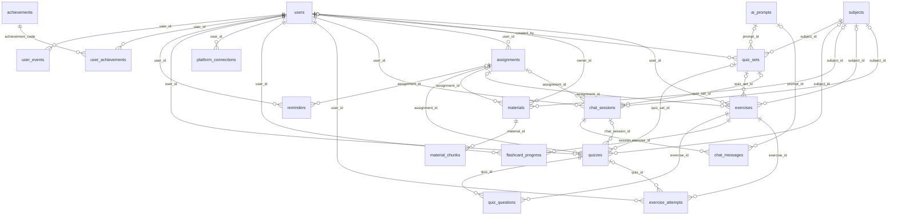

# Сущности LekseRadar (PostgreSQL 16 + Spring Boot)

Все таблицы, перечисления, виды и функции базы и как они отображаются в бэкенде (JPA-сущности, DTO)
и во фронтенде (TypeScript-типы). База — ветка `PythonAPI`, бэкенд — ветка `JavaAPI-setup`.
Источник правды — миграции `database/migrations/V1–V23`. Бэкенд таблицы не создаёт (`ddl-auto: none`),
поэтому поля сущностей должны совпадать с колонками ниже.

**Состояние бэкенда.** Сейчас в `JavaAPI-setup` есть только `User`, `ChatSession`, `ChatMessage`, `MessageRole`
и их репозитории. Остальные сущности и репозитории описаны в плане
[`backend/ENTITIES-PLAN.md`](https://github.com/two-bits1/LekseRadar/blob/JavaAPI-setup/backend/ENTITIES-PLAN.md):
их один раз написали и проверили, потом откатили (коммит `2b943e1`, вернуть: `git revert 2b943e1`).

**Пробных данных нет нигде.** База стартует пустой (seed.sql удалён, `assignments.is_demo` убран в V16),
`collect()` не выдумывает задания. Всё появляется только через API: регистрация и вход (Spring Security + JWT),
подключение платформ и синхронизация ДЗ, чаты, квизы от ИИ, загрузка материалов. Миграции заполняют только
справочники: список ачивок (`achievements`, V6) и режимы чата (`chat_mode_prompts`, V13).

Как база встроена в проект: [схема работы](../docs/schema.png), подробно в [docs/ARCHITECTURE.md](../docs/ARCHITECTURE.md),
SQL для каждого сценария — [README.md](README.md).

## Как читать

- **PostgreSQL** — тип колонки, **Java** — тип поля в JPA-сущности.
- **NULL** — «да», если колонка может быть пустой (в Java — обёртка `Long`, `Integer`, а не `long`).
- **Ключи:** PK — первичный ключ, FK → таблица.колонка и что происходит при удалении
  (CASCADE — удаляется вместе, SET NULL — ссылка обнуляется).
- **Бэкенд:** ✅ уже есть в `backend/.../model` и `.../repository`; 📝 описано в `ENTITIES-PLAN.md`, в коде пока нет.
  «Только чтение» — сущность `@Immutable`, а пишет функция базы через метод репозитория. 🕓 — эндпоинта ещё нет.
- Время везде `timestamptz` → `Instant` (UTC), в JSON — ISO-8601.

## Перечисления (PostgreSQL enum → Java enum)

В базе значения строчными буквами. В Java — enum с конвертером, как уже сделано для `chat_role`
(`MessageRole` + `MessageRoleConverter` + `@ColumnTransformer(write = "?::chat_role")`).
В JSON для фронта отдаём строчные значения, как в базе.

| PostgreSQL | Значения | Java enum | Где используется | Бэкенд |
|---|---|---|---|---|
| `chat_role` | `student`, `tutor`, `system` | `MessageRole` | `chat_messages.role` | ✅ |
| `chat_mode` | `tutor`, `quiz` | `ChatMode` | `chat_sessions.mode`, `chat_mode_prompts.mode` | 📝 |
| `platform` | `canvas`, `teams`, `itslearning`, `inschool`, `classroom` (V22) | `Platform` | `platform_connections.platform`, `assignments.source` | 📝 |
| `assignment_status` | `todo`, `overdue`, `submitted`, `graded` | `AssignmentStatus` | `assignments.status` | 📝 |
| `exercise_level` | `beginner`, `intermediate`, `advanced` | `ExerciseLevel` | `exercises`, `quizzes`, `quiz_sets`, `chat_sessions.level` | 📝 |
| `answer_type` | `exact`, `free` | `AnswerType` | `exercises.answer_type` | 📝 |
| `verdict` | `correct`, `incorrect`, `partial` | `Verdict` | `exercise_attempts.verdict`, `save_quiz_answer()` | 📝 |
| `quiz_status` | `in_progress`, `completed`, `abandoned` | `QuizStatus` | `quizzes.status` | 📝 |
| `material_source` | `upload`, `url`, `platform`, `teacher`, `seed` (не используется) | `MaterialSource` | `materials.source` | 📝 |

Типы вопросов квиза — не enum, а текст с CHECK: `exercises.question_type` = `single_choice` | `multiple_choice` | `text`
(Java: `QuestionType`).

## Связи между таблицами

Все внешние ключи. `||` — обязательная связь, `|o` — может быть пустой.



## Таблицы

### Пользователи

#### `users`

Ученик: вход, язык, часовой пояс. Бэкенд: ✅ `User`.

| Колонка | PostgreSQL | Java | NULL | По умолчанию | Ключи | Описание |
|---|---|---|---|---|---|---|
| `id` | bigint | Long | нет | `авто` | PK | ключ |
| `email` | citext | String | нет |  |  | логин, без учёта регистра |
| `password_hash` | text | String | нет |  |  | bcrypt из Spring Security |
| `display_name` | text | String | нет |  |  | имя на сайте |
| `locale` | text | String | нет | `'nb'` |  | язык интерфейса и тьютора |
| `timezone` | text | String | нет | `'Europe/Oslo'` |  | часовой пояс для дедлайнов |
| `created_at` | timestamptz | Instant | нет | `now()` |  | когда создано |
| `last_login_at` | timestamptz | Instant | да |  |  | последний вход |

Ограничения и индексы: `UNIQUE (email)`.

### Платформы и домашка

#### `platform_connections`

Подключённая платформа ученика и зашифрованный доступ к ней. Одна строка на (ученик, платформа). Бэкенд: 📝 `PlatformConnection`.

| Колонка | PostgreSQL | Java | NULL | По умолчанию | Ключи | Описание |
|---|---|---|---|---|---|---|
| `id` | bigint | Long | нет | `авто` | PK | ключ |
| `user_id` | bigint | Long | нет |  | FK → users.id CASCADE | ученик |
| `platform` | platform | enum `Platform` + конвертер | нет |  |  | canvas / teams / itslearning / inschool / classroom |
| `credentials_enc` | bytea | byte[] | нет |  |  | токены или cookie, зашифрованы бэкендом (AES-GCM) |
| `needs_reconnect` | boolean | Boolean | нет | `false` |  | нужно войти заново (из `SourceResult.needs_reconnect`) |
| `last_synced_at` | timestamptz | Instant | да |  |  | последний удачный сбор ДЗ |
| `last_error` | text | String | да |  |  | последняя ошибка сбора (из `SourceResult.error`) |
| `created_at` | timestamptz | Instant | нет | `now()` |  | когда создано |

Ограничения и индексы: `UNIQUE (user_id, platform)`.

#### `assignments`

ДЗ из `collect()`. При каждой синхронизации UPSERT по (user_id, source, external_id) через `sync_assignments()` (V21). Бэкенд: 📝 `Assignment`.

| Колонка | PostgreSQL | Java | NULL | По умолчанию | Ключи | Описание |
|---|---|---|---|---|---|---|
| `id` | bigint | Long | нет | `авто` | PK | ключ |
| `user_id` | bigint | Long | нет |  | FK → users.id CASCADE | ученик |
| `source` | platform | enum `Platform` + конвертер | нет |  |  | платформа, откуда ДЗ |
| `external_id` | text | String | нет |  |  | id задания на платформе (`Assignment.id` из `collect()`) |
| `title` | text | String | нет |  |  | название |
| `course` | text | String | нет | `''` |  | предмет / курс на платформе |
| `due_at` | timestamptz | Instant | да |  |  | дедлайн |
| `status` | assignment_status | enum `AssignmentStatus` + конвертер | нет | `'todo'::assignment_status` |  | todo / overdue / submitted / graded |
| `url` | text | String | да |  |  | ссылка на задание на платформе |
| `description` | text | String | нет | `''` |  | текст задания с платформы |
| `kind` | text | String | нет | `'assignment'` |  | assignment / quiz / exam / discussion / task |
| `first_seen_at` | timestamptz | Instant | нет | `now()` |  | когда впервые собрано |
| `updated_at` | timestamptz | Instant | нет | `now()` |  | когда изменено |

Ограничения и индексы: `UNIQUE (user_id, source, external_id)`; индекс `assignments_user_due btree (user_id, status, due_at)`.

### ИИ-чат

#### `chat_sessions`

Чат: репетитор (`tutor`) или генерация квизов (`quiz`). Создавать через `start_chat()`. Бэкенд: ✅ `ChatSession`, но без полей V13–V14 (`assignment_id`, `mode`, `subject_id`, `quiz_set_id`, `language`, `level`); 📝 они и `startChat()`, `systemPrompt()`, `promptVars()`, `setLanguage()` — в плане.

| Колонка | PostgreSQL | Java | NULL | По умолчанию | Ключи | Описание |
|---|---|---|---|---|---|---|
| `id` | bigint | Long | нет | `авто` | PK | ключ |
| `user_id` | bigint | Long | нет |  | FK → users.id CASCADE | ученик |
| `assignment_id` | bigint | Long | да |  | FK → assignments.id SET NULL | чат по конкретному ДЗ |
| `title` | text | String | нет | `'Ny samtale'` |  | название чата в списке |
| `topic` | text | String | да |  |  | тема |
| `archived` | boolean | Boolean | нет | `false` |  | в архиве |
| `created_at` | timestamptz | Instant | нет | `now()` |  | когда создано |
| `updated_at` | timestamptz | Instant | нет | `now()` |  | время последнего сообщения (триггер) |
| `mode` | chat_mode | enum `ChatMode` + конвертер | нет | `'tutor'::chat_mode` |  | tutor — репетитор, quiz — генерация квизов; не меняется |
| `subject_id` | bigint | Long | да |  | FK → subjects.id | предмет |
| `quiz_set_id` | bigint | Long | да |  | FK → quiz_sets.id SET NULL | квиз, созданный в этом чате |
| `language` | text | String | да |  |  | свой язык чата; NULL — язык сайта (`users.locale`), см. V17 |
| `level` | exercise_level | enum `ExerciseLevel` + конвертер | нет | `'intermediate'::exercise_level` |  | уровень квиза в чате quiz |

Ограничения и индексы: `CHECK ((language ~ '^[a-z]{2,3}$'))`; индекс `chat_sessions_user btree (user_id, updated_at DESC)`; индекс `chat_sessions_user_mode btree (user_id, mode, updated_at DESC)`.

#### `chat_messages`

Сообщения чата. История для ИИ — вид `chat_context`. Бэкенд: ✅ `ChatMessage`, `findContext()` читает вид; 📝 нет поля `prompt_id` (V13).

| Колонка | PostgreSQL | Java | NULL | По умолчанию | Ключи | Описание |
|---|---|---|---|---|---|---|
| `id` | bigint | Long | нет | `авто` | PK | ключ |
| `session_id` | bigint | Long | нет |  | FK → chat_sessions.id CASCADE | чат |
| `role` | chat_role | enum `MessageRole` + конвертер | нет |  |  | student / tutor / system |
| `content` | text | String | нет |  |  | текст, 1–8000 символов |
| `on_topic` | boolean | Boolean | да |  |  | вопрос про учёбу или нет (только у ответов тьютора) |
| `model` | text | String | да |  |  | какая модель ответила |
| `tokens_used` | integer | Integer | да |  |  | сколько токенов потратил ответ |
| `created_at` | timestamptz | Instant | нет | `now()` |  | время сообщения |
| `prompt_id` | bigint | Long | да |  | FK → ai_prompts.id | какая версия промпта использована |

Ограничения и индексы: `CHECK (((length(content) >= 1) AND (length(content) <= 8000)))`; индекс `chat_messages_session btree (session_id, created_at)`.

#### `chat_mode_prompts`

Какой промпт подключён к режиму чата. Бэкенд: 📝 `ChatModePrompt` (только чтение; id — текст режима).

| Колонка | PostgreSQL | Java | NULL | По умолчанию | Ключи | Описание |
|---|---|---|---|---|---|---|
| `mode` | chat_mode | enum `ChatMode` + конвертер | нет |  | PK | режим чата |
| `prompt_key` | text | String | нет |  |  | какой промпт у режима |

### Промпты и учебные материалы

#### `ai_prompts`

Промпты ИИ с версиями, одна активная версия на ключ. Бэкенд: 📝 `AiPrompt` (только чтение), `AiPromptRepository.getActiveContent()` = `get_prompt()`; грузит `ai-content/load/load.py`.

| Колонка | PostgreSQL | Java | NULL | По умолчанию | Ключи | Описание |
|---|---|---|---|---|---|---|
| `id` | bigint | Long | нет | `авто` | PK | ключ |
| `key` | text | String | нет |  |  | tutor, quiz_generator, answer_checker … |
| `version` | integer | Integer | нет |  |  | номер версии |
| `content` | text | String | нет |  |  | текст промпта с {{переменными}} |
| `content_hash` | text | String | нет |  |  | md5 текста, защита от дублей |
| `is_active` | boolean | Boolean | нет | `true` |  | активная версия (одна на ключ) |
| `note` | text | String | да |  |  | откуда загружен |
| `created_at` | timestamptz | Instant | нет | `now()` |  | когда создано |

Ограничения и индексы: `UNIQUE (key, version)`; `CHECK ((btrim(content) <> ''))`; `CHECK ((key ~ '^[a-z0-9_]+$'))`; индекс `UNIQUE ai_prompts_one_active btree (key) WHERE is_active`.

#### `materials`

Учебные файлы для ИИ-репетитора и файлы ДЗ (как текст). Бэкенд: 📝 `Material` (только чтение); добавлять через `add_material()` / `attach_homework_file()`.

| Колонка | PostgreSQL | Java | NULL | По умолчанию | Ключи | Описание |
|---|---|---|---|---|---|---|
| `id` | bigint | Long | нет | `авто` | PK | ключ |
| `owner_id` | bigint | Long | да |  | FK → users.id CASCADE | NULL = общий материал для всех |
| `subject_id` | bigint | Long | да |  | FK → subjects.id | предмет |
| `topic` | text | String | да |  |  | тема |
| `topic_key` | text | String | да | `вычисляется: norm_key(topic)` |  | тема в нижнем регистре для поиска |
| `title` | text | String | нет |  |  | название материала |
| `file_name` | text | String | да |  |  | имя файла |
| `mime_type` | text | String | да |  |  | тип файла |
| `file_size` | bigint | Long | да |  |  | размер в байтах |
| `storage_key` | text | String | да |  |  | где лежит оригинал файла |
| `source` | material_source | enum `MaterialSource` + конвертер | нет | `'upload'::material_source` |  | upload / url / platform / teacher (seed не используется) |
| `source_url` | text | String | да |  |  | ссылка-источник |
| `language` | text | String | нет | `'nb'` |  | язык (nb, en, ru, uk …) |
| `content_hash` | text | String | нет |  |  | md5 текста: повторная загрузка не дублирует |
| `char_count` | integer | Integer | нет | `0` |  | длина текста |
| `chunk_count` | integer | Integer | нет | `0` |  | на сколько фрагментов нарезан |
| `created_at` | timestamptz | Instant | нет | `now()` |  | когда создано |
| `assignment_id` | bigint | Long | да |  | FK → assignments.id SET NULL | файл ДЗ, если материал — текст задания |

Ограничения и индексы: `CHECK (((length(title) >= 1) AND (length(title) <= 300)))`; индекс `UNIQUE materials_dedup btree (COALESCE(owner_id, (0)::bigint), content_hash)`; индекс `materials_owner btree (owner_id, created_at DESC)`; индекс `materials_subject btree (subject_id, topic_key)`; индекс `materials_assignment btree (assignment_id)`.

#### `material_chunks`

Фрагменты материалов с полнотекстовым индексом. Бэкенд: 📝 `MaterialChunk` (только чтение, без `tsv`); поиск `MaterialRepository.search()` / `forPrompt()`.

| Колонка | PostgreSQL | Java | NULL | По умолчанию | Ключи | Описание |
|---|---|---|---|---|---|---|
| `id` | bigint | Long | нет | `авто` | PK | ключ |
| `material_id` | bigint | Long | нет |  | FK → materials.id CASCADE | материал |
| `position` | integer | Integer | нет |  |  | порядковый номер |
| `content` | text | String | нет |  |  | фрагмент текста (~1200 символов) |
| `tsv` | tsvector | — (не маппить) | да | `вычисляется: to_tsvector('simple'::regco…` |  | индекс полнотекстового поиска |

Ограничения и индексы: `UNIQUE (material_id, "position")`; индекс `material_chunks_tsv gin (tsv)`.

### Квизы

#### `subjects`

Предметы для выбора в квизе. Создаются сами при импорте квиза или создании чата. Бэкенд: 📝 `Subject`.

| Колонка | PostgreSQL | Java | NULL | По умолчанию | Ключи | Описание |
|---|---|---|---|---|---|---|
| `id` | bigint | Long | нет | `авто` | PK | ключ |
| `name` | text | String | нет |  |  | название предмета как ввёл пользователь |
| `key` | text | String | нет |  |  | нормализованное имя: lower, без лишних пробелов |
| `created_at` | timestamptz | Instant | нет | `now()` |  | когда создано |

Ограничения и индексы: `UNIQUE (key)`.

#### `quiz_sets`

Сохранённый квиз от ИИ: один JSON на (предмет, тема, уровень, язык), используется снова. Бэкенд: 📝 `QuizSet` (только чтение); создавать через `import_quiz_json()`.

| Колонка | PostgreSQL | Java | NULL | По умолчанию | Ключи | Описание |
|---|---|---|---|---|---|---|
| `id` | bigint | Long | нет | `авто` | PK | ключ |
| `subject_id` | bigint | Long | нет |  | FK → subjects.id | предмет |
| `topic` | text | String | нет |  |  | тема |
| `topic_key` | text | String | нет |  |  | тема в нижнем регистре для поиска |
| `level` | exercise_level | enum `ExerciseLevel` + конвертер | нет |  |  | уровень сложности |
| `language` | text | String | нет | `'nb'` |  | язык (nb, en, ru, uk …) |
| `title` | text | String | нет |  |  | название |
| `question_count` | integer | Integer | нет |  |  | сколько вопросов |
| `source_json` | jsonb | String (JSON) / JsonNode | нет |  |  | исходный JSON от ИИ как есть |
| `content_hash` | text | String | нет |  |  | md5 вопросов: один и тот же JSON не импортируется дважды |
| `model` | text | String | да |  |  | какая модель сгенерировала |
| `created_by` | bigint | Long | да |  | FK → users.id SET NULL | кто первым сгенерировал |
| `times_used` | integer | Integer | нет | `0` |  | сколько раз квиз запускали |
| `created_at` | timestamptz | Instant | нет | `now()` |  | когда создано |
| `material_ids` | int8[] | List<Long> | нет | `'{}'::bigint[]` |  | какие материалы ИИ использовал |
| `prompt_id` | bigint | Long | да |  | FK → ai_prompts.id | какая версия промпта использована |

Ограничения и индексы: `UNIQUE (content_hash)`; `CHECK (((length(topic) >= 1) AND (length(topic) <= 100)))`; индекс `quiz_sets_lookup btree (subject_id, topic_key, level, language, created_at DESC)`.

#### `exercises`

Вопросы квиза. Они же — флеш-карты. Бэкенд: 📝 `Exercise` (только чтение); вопросы без ответов — вид `quiz_questions_public`.

| Колонка | PostgreSQL | Java | NULL | По умолчанию | Ключи | Описание |
|---|---|---|---|---|---|---|
| `id` | bigint | Long | нет | `авто` | PK | ключ |
| `user_id` | bigint | Long | да |  | FK → users.id CASCADE | NULL = общий каталог |
| `assignment_id` | bigint | Long | да |  | FK → assignments.id SET NULL | ДЗ, к которому относится |
| `topic` | text | String | нет |  |  | тема |
| `level` | exercise_level | enum `ExerciseLevel` + конвертер | нет |  |  | уровень сложности |
| `statement` | text | String | нет |  |  | текст вопроса |
| `correct_answer` | text | String | нет |  |  | правильный ответ (для multiple_choice — JSON-массив) |
| `answer_type` | answer_type | enum `AnswerType` + конвертер | нет |  |  | exact — сравнение, free — проверяет ИИ |
| `options` | jsonb | String (JSON) / JsonNode | да |  |  | варианты ответа для квиза с выбором; NULL = ответ текстом |
| `generated` | boolean | Boolean | нет | `true` |  | сгенерирован ИИ |
| `created_at` | timestamptz | Instant | нет | `now()` |  | когда создано |
| `subject_id` | bigint | Long | да |  | FK → subjects.id | предмет |
| `quiz_set_id` | bigint | Long | да |  | FK → quiz_sets.id CASCADE | набор вопросов квиза |
| `position` | integer | Integer | да |  |  | порядковый номер |
| `question_type` | text | String | нет | `'text'` |  | single_choice / multiple_choice / text |
| `explanation` | text | String | да |  |  | пояснение к правильному ответу |

Ограничения и индексы: `UNIQUE (quiz_set_id, "position")`; `CHECK (((length(correct_answer) >= 1) AND (length(correct_answer) <= 2000)))`; `CHECK ((question_type = ANY (ARRAY['single_choice', 'multiple_choice', 'text'])))`; `CHECK (((length(statement) >= 1) AND (length(statement) <= 2000)))`; `CHECK (((length(topic) >= 1) AND (length(topic) <= 100)))`; индекс `exercises_topic btree (topic, level)`; индекс `UNIQUE exercises_set_position btree (quiz_set_id, "position")`.

#### `quizzes`

Попытка ученика пройти квиз, с местом, где он остановился. Бэкенд: 📝 `Quiz`; старт `start_quiz()`, конец `finish_quiz()`.

| Колонка | PostgreSQL | Java | NULL | По умолчанию | Ключи | Описание |
|---|---|---|---|---|---|---|
| `id` | bigint | Long | нет | `авто` | PK | ключ |
| `user_id` | bigint | Long | нет |  | FK → users.id CASCADE | ученик |
| `assignment_id` | bigint | Long | да |  | FK → assignments.id SET NULL | квиз по ДЗ |
| `chat_session_id` | bigint | Long | да |  | FK → chat_sessions.id SET NULL | квиз из чата |
| `title` | text | String | нет |  |  | название квиза |
| `topic` | text | String | нет |  |  | тема |
| `level` | exercise_level | enum `ExerciseLevel` + конвертер | нет |  |  | уровень сложности |
| `status` | quiz_status | enum `QuizStatus` + конвертер | нет | `'in_progress'::quiz_status` |  | in_progress / completed / abandoned |
| `score` | numeric | BigDecimal | да |  |  | итог 0–100, ставит `finish_quiz()` |
| `started_at` | timestamptz | Instant | нет | `now()` |  | начало |
| `completed_at` | timestamptz | Instant | да |  |  | конец |
| `subject_id` | bigint | Long | да |  | FK → subjects.id | предмет |
| `quiz_set_id` | bigint | Long | да |  | FK → quiz_sets.id | набор вопросов квиза |
| `current_position` | integer | Integer | нет | `1` |  | на каком вопросе остановился |

Ограничения и индексы: `CHECK (((score >= (0)::numeric) AND (score <= (100)::numeric)))`; индекс `quizzes_user btree (user_id, started_at DESC)`; индекс `quizzes_user_set btree (user_id, quiz_set_id)`.

#### `quiz_questions`

Порядок вопросов в попытке. Бэкенд: 📝 `QuizQuestion` (только чтение); заполняет `start_quiz()`.

| Колонка | PostgreSQL | Java | NULL | По умолчанию | Ключи | Описание |
|---|---|---|---|---|---|---|
| `quiz_id` | bigint | Long | нет |  | PK, FK → quizzes.id CASCADE | попытка квиза |
| `position` | integer | Integer | нет |  | PK | порядковый номер |
| `exercise_id` | bigint | Long | нет |  | FK → exercises.id | вопрос |

Ограничения и индексы: `UNIQUE (quiz_id, exercise_id)`; `CHECK (("position" >= 1))`.

#### `exercise_attempts`

Ответы ученика с вердиктом. Бэкенд: 📝 `ExerciseAttempt` (только чтение); писать через `save_quiz_answer()`.

| Колонка | PostgreSQL | Java | NULL | По умолчанию | Ключи | Описание |
|---|---|---|---|---|---|---|
| `id` | bigint | Long | нет | `авто` | PK | ключ |
| `user_id` | bigint | Long | нет |  | FK → users.id CASCADE | ученик |
| `exercise_id` | bigint | Long | нет |  | FK → exercises.id CASCADE | вопрос |
| `quiz_id` | bigint | Long | да |  | FK → quizzes.id CASCADE | попытка квиза |
| `answer` | text | String | нет |  |  | ответ ученика |
| `verdict` | verdict | enum `Verdict` + конвертер | нет |  |  | correct / incorrect / partial |
| `explanation` | text | String | да |  |  | пояснение к ответу |
| `created_at` | timestamptz | Instant | нет | `now()` |  | когда ответил |

Ограничения и индексы: `CHECK (((length(answer) >= 1) AND (length(answer) <= 4000)))`; индекс `attempts_user btree (user_id, created_at DESC)`; индекс `attempts_quiz btree (quiz_id)`.

### Флеш-карты

#### `flashcard_progress`

Колода ученика и расписание повторов SM-2. Карточка = вопрос из `exercises`. Бэкенд: 📝 `FlashcardProgress` (только чтение), `FlashcardRepository`: `findDueCards()`, `addQuizSet()`, `review()`, `findStats()`.

| Колонка | PostgreSQL | Java | NULL | По умолчанию | Ключи | Описание |
|---|---|---|---|---|---|---|
| `user_id` | bigint | Long | нет |  | PK, FK → users.id CASCADE | ученик |
| `exercise_id` | bigint | Long | нет |  | PK, FK → exercises.id CASCADE | вопрос |
| `ease` | numeric | BigDecimal | нет | `2.5` |  | SM-2: насколько легко даётся |
| `interval_days` | integer | Integer | нет | `0` |  | через сколько дней повтор |
| `repetitions` | integer | Integer | нет | `0` |  | успешных повторов подряд |
| `reviews` | integer | Integer | нет | `0` |  | сколько раз повторял |
| `lapses` | integer | Integer | нет | `0` |  | сколько раз забыл |
| `next_review_at` | timestamptz | Instant | нет | `now()` |  | когда показать снова |
| `last_reviewed_at` | timestamptz | Instant | да |  |  | последний повтор |
| `added_at` | timestamptz | Instant | нет | `now()` |  | когда попала в колоду |

Ограничения и индексы: индекс `flashcard_progress_due btree (user_id, next_review_at)`.

### История, напоминания, ачивки

#### `user_events`

Лента всех действий: из неё строятся история, активные дни и ачивки. Бэкенд: ✅ `UserEventRepository.add(...)` через JDBC; 📝 сущность `UserEvent` и лента — в плане.

| Колонка | PostgreSQL | Java | NULL | По умолчанию | Ключи | Описание |
|---|---|---|---|---|---|---|
| `id` | bigint | Long | нет | `авто` | PK | ключ |
| `user_id` | bigint | Long | нет |  | FK → users.id CASCADE | ученик |
| `type` | text | String | нет |  |  | что произошло: chat_started, quiz_completed, material_added … |
| `ref_table` | text | String | да |  |  | например 'quizzes' |
| `ref_id` | bigint | Long | да |  |  | id строки в ref_table |
| `payload` | jsonb | String (JSON) / JsonNode | нет | `'{}'::jsonb` |  | детали события |
| `created_at` | timestamptz | Instant | нет | `now()` |  | когда создано |

Ограничения и индексы: индекс `user_events_user btree (user_id, created_at DESC)`.

#### `reminders`

Напоминания о дедлайнах. Бэкенд: 📝 `Reminder`.

| Колонка | PostgreSQL | Java | NULL | По умолчанию | Ключи | Описание |
|---|---|---|---|---|---|---|
| `id` | bigint | Long | нет | `авто` | PK | ключ |
| `user_id` | bigint | Long | нет |  | FK → users.id CASCADE | ученик |
| `assignment_id` | bigint | Long | да |  | FK → assignments.id CASCADE | ДЗ, к которому относится |
| `message` | text | String | нет |  |  | текст напоминания |
| `remind_at` | timestamptz | Instant | нет |  |  | когда напомнить |
| `channel` | text | String | нет | `'in_app'` |  | in_app / email / push |
| `sent_at` | timestamptz | Instant | да |  |  | когда отправлено; NULL — ещё нет |
| `created_at` | timestamptz | Instant | нет | `now()` |  | когда создано |

Ограничения и индексы: индекс `reminders_due btree (remind_at) WHERE (sent_at IS NULL)`.

#### `achievements`

Список ачивок, заполнен миграцией. Бэкенд: 📝 `Achievement` (справочник).

| Колонка | PostgreSQL | Java | NULL | По умолчанию | Ключи | Описание |
|---|---|---|---|---|---|---|
| `code` | text | String | нет |  | PK | например 'first_quiz' |
| `title` | text | String | нет |  |  | название |
| `description` | text | String | нет |  |  | за что даётся |
| `icon` | text | String | да |  |  | иконка |

#### `user_achievements`

Какие ачивки получил ученик. Бэкенд: 📝 `UserAchievement`.

| Колонка | PostgreSQL | Java | NULL | По умолчанию | Ключи | Описание |
|---|---|---|---|---|---|---|
| `user_id` | bigint | Long | нет |  | PK, FK → users.id CASCADE | ученик |
| `achievement_code` | text | String | нет |  | PK, FK → achievements.code | какая ачивка |
| `unlocked_at` | timestamptz | Instant | нет | `now()` |  | когда получена |

## Виды (view): готовые выборки только для чтения

В Java — интерфейс-проекция или record + `@Query(nativeQuery = true)`, как уже сделано для `chat_context`
(`ChatMessageRepository.findContext`). Всегда фильтровать по `user_id` текущего ученика.

| Вид | Колонки | Для чего | Эндпоинт |
|---|---|---|---|
| `chat_context` | `session_id`, `role` chat_role, `content`, `created_at` | последние 10 сообщений чата (без `system`) для запроса к ИИ | внутри `POST /chats/{id}/messages` ✅ |
| `user_chats` | `id`, `user_id`, `mode` chat_mode, `title`, `subject`, `topic`, `quiz_set_id`, `assignment_id`, `archived`, `updated_at`, `message_count` | список чатов с предметом и числом сообщений | `GET /chats` 🕓 (сейчас читает таблицу) |
| `quiz_questions_public` | `quiz_id`, `position`, `exercise_id`, `question_type`, `question`, `options` jsonb | вопросы попытки **без правильных ответов** — только это отдавать фронту | `GET /quizzes/{id}` 🕓 |
| `user_quiz_progress` | `user_id`, `subject`, `topic`, `quizzes_completed`, `quizzes_in_progress`, `best_score`, `last_score`, `last_activity` | прогресс по квизам: предмет и тема | `GET /dashboard` 🕓 |
| `flashcards` | `user_id`, `exercise_id`, `quiz_set_id`, `subject`, `topic`, `front`, `back`, `explanation`, `next_review_at`, `interval_days`, `reviews`, `due` | карточки ученика: `front` — вопрос, `back` — ответ; `due = true` — пора повторить | `GET /flashcards/due` 🕓 |
| `user_flashcard_stats` | `user_id`, `cards`, `due_now`, `learned`, `reviews` | сводка по колоде | `GET /dashboard` 🕓 |
| `user_topic_progress` | `user_id`, `topic`, `attempts`, `correct`, `partial`, `mastery_pct`, `last_activity` | освоение тем в % (partial = 0,5) | `GET /dashboard`, слабые темы в промпте 🕓 |
| `user_daily_activity` | `user_id`, `day` date, `events`, `exercises`, `quizzes` | активность по дням для графика | `GET /dashboard` 🕓 |
| `user_dashboard` | `user_id`, `homework_todo`, `homework_overdue`, `homework_done`, `quizzes_completed`, `avg_quiz_score`, `exercises_answered`, `questions_asked`, `active_days_30` | цифры для карточек дашборда, одна строка на ученика | `GET /dashboard` 🕓 |
| `user_materials` | `id`, `owner_id`, `title`, `subject`, `topic`, `file_name`, `mime_type`, `file_size`, `source` material_source, `language`, `chunk_count`, `created_at` | список учебных материалов (свои + общие, где `owner_id IS NULL`) | `GET /materials` 🕓 |

Числа `bigint` из `count(*)` → `Long`, `numeric` → `BigDecimal` (или `Double` в DTO).

## Функции базы (вызывать из Java)

Логику квизов, карточек, промптов и материалов держит база: правила одни для всех, бэкенду достаточно вызвать
функцию. В Java — `@Query(value = "SELECT ...", nativeQuery = true)` в репозитории или `JdbcTemplate`.
Функции, которые возвращают `TABLE(...)`, вызываются как `SELECT * FROM f(...)`.

### Домашка

| Функция | Аргументы | Возвращает | Что делает | Эндпоинт |
|---|---|---|---|---|
| `sync_assignments` (V21) | `p_user` bigint, `items` jsonb | `TABLE(added int, updated int)` | `CollectResult.assignments` из `collector` → UPSERT в `assignments`. Не откатывает `submitted`/`graded`, выставленные на сайте; пустое описание не затирает сохранённое; пропавшие задания не удаляет | `POST /homework/sync`, `homework.to_db` |

Вызов из Java: `SELECT added, updated FROM sync_assignments(:userId, CAST(:assignments AS jsonb))`, где `:assignments` — массив
`assignments` из ответа `collector` как строка JSON.

### Чат и промпты

| Функция | Аргументы | Возвращает | Что делает | Эндпоинт |
|---|---|---|---|---|
| `start_chat` | `p_user` bigint, `p_mode` chat_mode, `p_subject` text, `p_topic` text, `p_title` text, `p_assignment` bigint | `bigint` id чата | создаёт чат нужного режима, предмет при необходимости, событие `chat_started` | `POST /chats` |
| `chat_system_prompt` | `p_session` bigint | `TABLE(prompt_id, prompt_key, version, content, mode, user_id, subject_id, subject, topic, language)` | активный промпт режима чата; ошибка, если промпт не загружен | `POST /chats/{id}/messages` |
| `chat_prompt_vars` | `p_session` bigint | `jsonb` | значения `{{language}}`, `{{language_code}}` (код, V20), `{{subject}}`, `{{topic}}`, `{{level}}`, `{{homework_title}}`, `{{homework_due}}`, `{{homework_text}}`, `{{weak_topics}}` | `POST /chats/{id}/messages` |
| `set_chat_language` | `p_session` bigint, `p_language` text | — | сохранить язык, когда ИИ вернул метку `[[LANGUAGE=xx]]` | `POST /chats/{id}/messages` |
| `get_prompt` | `p_key` text | `text` | активная версия промпта (`answer_checker` и др.) | проверка ответа квиза |
| `save_prompt` | `p_key`, `p_content`, `p_note` text | `int` версия | новая версия промпта, если текст изменился | `load.py` |
| `activate_prompt` | `p_key` text, `p_version` int | — | откат на старую версию | вручную |

### Учебные материалы и файл ДЗ

| Функция | Аргументы | Возвращает | Что делает | Эндпоинт |
|---|---|---|---|---|
| `add_material` | `p_owner` bigint (NULL — общий), `p_subject`, `p_topic`, `p_title`, `p_content` text, `p_file_name`, `p_mime_type`, `p_source` material_source, `p_language`, `p_storage_key`, `p_source_url`, `p_chunk_size` int = 1200 | `bigint` id | сохраняет текст файла и режет на фрагменты; повтор того же текста не дублирует | `POST /materials` |
| `attach_homework_file` | `p_assignment` bigint, `p_text` text, `p_file_name`, `p_mime_type`, `p_storage_key` | `bigint` id материала | текст файла ДЗ → материал, привязанный к заданию; попадает в `{{homework_text}}` | `POST /homework/{id}/file` |
| `search_materials` | `p_user` bigint, `p_query` text, `p_subject_id` bigint, `p_limit` int = 5, `p_topic` text | `TABLE(chunk_id, material_id, title, topic, chunk_pos, content, score)` | полнотекстовый поиск фрагментов (свои + общие материалы) | ссылки `[M<id>]` на фронте |
| `materials_for_prompt` | те же | `text` | готовый текст для `{{materials}}` | `POST /chats/{id}/messages` |
| `clip_text` | `p_text` text, `p_max` int = 12000 | `text` | обрезает длинный текст для промпта | внутри `chat_prompt_vars` |

### Квизы

| Функция | Аргументы | Возвращает | Что делает | Эндпоинт |
|---|---|---|---|---|
| `find_quiz_set` | `p_subject` text, `p_topic` text, `p_level` exercise_level, `p_language` text = 'nb' | `bigint` или NULL | есть ли готовый квиз по теме — тогда ИИ не вызываем | `POST /quizzes` |
| `import_quiz_json` | `p_json` jsonb (формат `quiz/quiz.schema.json`), `p_user` bigint | `bigint` id набора | проверяет JSON от ИИ, сохраняет квиз и вопросы; тот же JSON второй раз не импортируется | `POST /quizzes` |
| `start_quiz` | `p_user` bigint, `p_set` bigint | `bigint` id попытки | начинает попытку или продолжает незаконченную | `POST /quizzes` |
| `save_quiz_answer` | `p_quiz` bigint, `p_position` int, `p_answer` text, `p_verdict` verdict, `p_explanation` text | `TABLE(attempt_id, verdict, explanation, correct_answer)` | выбор проверяет сам; для `text` нужен `p_verdict` от ИИ (`answer_checker`) | `POST /quizzes/{id}/answers` |
| `finish_quiz` | `p_quiz` bigint | `numeric` балл 0–100 | завершает попытку, считает балл (partial = 0,5) | `POST /quizzes/{id}/finish` |

### Флеш-карты

| Функция | Аргументы | Возвращает | Что делает | Эндпоинт |
|---|---|---|---|---|
| `add_quiz_set_to_flashcards` | `p_user` bigint, `p_set` bigint | `int` сколько добавлено | все вопросы квиза в колоду | `POST /flashcards/from-quiz/{setId}` |
| `review_flashcard` | `p_user` bigint, `p_exercise` bigint, `p_grade` int 0–5 | `TABLE(next_review_at, interval_days)` | оценка карточки, следующий повтор по SM-2 | `POST /flashcards/{id}/review` |

### Служебные и триггеры (сами не вызывать)

| Имя | Что делает |
|---|---|
| `norm_key(text)` | нормализует предмет и тему для поиска: нижний регистр, одинарные пробелы |
| `split_text(text, int)` | режет текст на фрагменты для `add_material` |
| `question_tsquery(text)` | вопрос ученика → поисковый запрос (слова через ИЛИ, длинные по началу) |
| триггер `touch_chat_session` | новое сообщение поднимает чат наверх (`updated_at`) |
| триггер `attempt_to_flashcard` | неверный или частичный ответ в квизе → карточка в колоду, повтор сразу |
| триггер `chat_mode_locked` | запрещает менять режим чата |

## Бэкенд: вход и регистрация (Spring Security)

Всё про пользователя идёт только через Java: таблицу `users` пишет только бэкенд.

| Шаг | Где | Что происходит |
|---|---|---|
| Регистрация | `POST /api/v1/auth/register` → `AuthService.register` | email без учёта регистра (`existsByEmailIgnoreCase`, занят → 409), пароль → `BCryptPasswordEncoder`, `users` + событие в `user_events`, ответ `AuthResponse` с JWT |
| Вход | `POST /api/v1/auth/login` → `AuthService.login` | проверка bcrypt, неверно → 401, `last_login_at = now()`, JWT на `JWT_TTL_HOURS` (72 ч) |
| Остальные запросы | `JwtAuthenticationFilter` | `Authorization: Bearer <token>` → `UserRepository.findById` → пользователь в `SecurityContext`; нет токена → 401 JSON |
| Настройка | `SecurityConfig` | без сессий (`STATELESS`), CSRF выключен (JWT), открыты только `/api/v1/auth/**`, health и Swagger |
| Чужие данные | репозитории `findByIdAndUserId` | чужой чат, квиз, ДЗ или напоминание → 404 |

Проверено на пустой базе (V1–V16, до отката Java-кода): без токена 401, демо-вход 401 (такого пользователя нет), регистрация 201,
повтор email в другом регистре 409, неверный пароль 401, `GET /users/me` 200, создание чата и отправка сообщения
(ИИ без ключа → 502, вопрос ученика сохранён).

## Бэкенд: сущности и репозитории (план)

Сейчас в коде есть только `User`, `ChatSession`, `ChatMessage`. Ниже — как смаппить все 20 таблиц,
подробно с кодом в `backend/ENTITIES-PLAN.md` (ветка `JavaAPI-setup`).

Перечисления: `DbEnum` (значение в базе и JSON) + общий `converter/DbEnumConverter`, у каждого enum свой
конвертер с `autoApply`. Колонки PostgreSQL-ENUM помечены `columnDefinition` (для `validate`) и при записи
`@ColumnTransformer(write = "?::тип")`. В `application.yml` у пула `stringtype: unspecified`: без этого поиск
вида `WHERE platform = ?` падает с `operator does not exist: platform = character varying`.

| Сущность | Таблица | Пишет | Репозиторий и главные методы |
|---|---|---|---|
| `User` | `users` | Java | `UserRepository`: `findByEmailIgnoreCase`, `findDashboard`, `findTopicProgress`, `findDailyActivity` (виды) |
| `PlatformConnection` | `platform_connections` | Java (`credentialsEnc` шифровать AES-GCM) | `PlatformConnectionRepository`: `findByUserIdAndPlatform`, `markSynced()` |
| `Assignment` | `assignments` | Java, upsert | `AssignmentRepository`: `findForUser`, `upsert(...)` из `collect()`, `attachHomeworkFile` |
| `ChatSession` | `chat_sessions` | Java / `start_chat()` | `ChatSessionRepository`: `startChat`, `systemPrompt`, `promptVars`, `setLanguage` |
| `ChatMessage` | `chat_messages` | Java | `ChatMessageRepository`: `findContext` (вид `chat_context`) |
| `ChatModePrompt` | `chat_mode_prompts` | миграция V13 | `ChatModePromptRepository` |
| `AiPrompt` | `ai_prompts` | `save_prompt()` (load.py) | `AiPromptRepository`: `findByKeyAndActiveTrue`, `getActiveContent` |
| `Subject` | `subjects` | функции базы | `SubjectRepository`: `findByName` (как `norm_key`) |
| `QuizSet` | `quiz_sets` | `import_quiz_json()` | `QuizSetRepository`: `find`, `importJson` |
| `Exercise` | `exercises` | `import_quiz_json()` | `ExerciseRepository`: `findByQuizSetIdOrderByPosition` |
| `Quiz` | `quizzes` | `start_quiz()`, `finish_quiz()` | `QuizRepository`: `start`, `findPublicQuestions`, `saveAnswer`, `finish`, `findProgress` |
| `QuizQuestion` | `quiz_questions` | `start_quiz()` | `QuizQuestionRepository` |
| `ExerciseAttempt` | `exercise_attempts` | `save_quiz_answer()` | `ExerciseAttemptRepository` |
| `FlashcardProgress` | `flashcard_progress` | функции V9, триггер | `FlashcardRepository`: `findDueCards`, `addQuizSet`, `review`, `findStats` |
| `Material` | `materials` | `add_material()`, `attach_homework_file()` | `MaterialRepository`: `findVisible`, `add`, `search`, `forPrompt` |
| `MaterialChunk` | `material_chunks` | `add_material()` | `MaterialChunkRepository` |
| `Reminder` | `reminders` | Java | `ReminderRepository`: `findDue` |
| `Achievement` | `achievements` | миграция V6 (справочник) | `AchievementRepository` |
| `UserAchievement` | `user_achievements` | Java | `UserAchievementRepository`: `unlock` (повтор ничего не делает) |
| `UserEvent` | `user_events` | Java и функции базы | `UserEventRepository`: `add`, лента |

Проверка (была в откатанном коде): `backend/src/test/.../RepositoriesIntegrationTest` проходил все репозитории на настоящей базе
(регистрация и вход, ДЗ и платформы, чат с промптом, квиз → карточки → прогресс, материалы и поиск) в транзакции
с откатом. Запуск: `TEST_DB_URL=jdbc:postgresql://localhost:5432/lekseradar ./mvnw test`, без переменной тест пропускается.

## Бэкенд: что ещё добавить

Кроме сущностей и репозиториев из плана, нет сервисов и контроллеров для ДЗ, платформ, квизов, карточек, дашборда,
материалов и напоминаний (в списке видов выше они помечены 🕓). `ChatService` пока создаёт чат сам и берёт
промпт из `Prompts.java`, а не из `chatSessions.systemPrompt()`.

DTO: в `CreateChatRequest` добавить `mode` (`tutor` | `quiz`), `subject`, `assignmentId`, `level`;
в `ChatResponse` — `mode`, `subject`, `language`, `assignmentId`, `quizSetId`.
`UpdateProfileRequest.locale` разрешает `nb|nn|en|ru`, а репетитор предлагает ещё `uk` — стоит добавить `uk`.

### DTO, которые ещё нужны для API

```java
// ДЗ                                         GET /homework, POST /homework/sync
record AssignmentResponse(Long id, Platform source, String title, String course, Instant dueAt,
                          AssignmentStatus status, String url, String kind) {}
record SyncResponse(List<SourceStatus> sources, int count) {}
record SourceStatus(Platform platform, boolean ok, int count, String error, boolean needsReconnect) {}

// Платформы                                  GET /platforms, POST/DELETE /platforms/{platform}
record PlatformResponse(Platform platform, boolean connected, boolean needsReconnect,
                        Instant lastSyncedAt, String lastError) {}

// Квизы                                      GET /subjects, POST /quizzes, GET /quizzes/{id}
record SubjectResponse(Long id, String name) {}
record StartQuizRequest(@NotBlank String subject, @NotBlank String topic, ExerciseLevel level,
                        Long assignmentId) {}
record QuizResponse(Long id, Long quizSetId, String title, String subject, String topic,
                    ExerciseLevel level, QuizStatus status, int currentPosition,
                    List<QuestionResponse> questions) {}
record QuestionResponse(int position, Long exerciseId, QuestionType type, String question,
                        List<String> options) {}          // без правильного ответа!
// POST /quizzes/{id}/answers, POST /quizzes/{id}/finish
record AnswerRequest(@Min(1) int position, @NotBlank String answer) {}     // multiple_choice: JSON-массив строкой
record AnswerResponse(Verdict verdict, String explanation, String correctAnswer) {}
record FinishResponse(BigDecimal score) {}

// Флеш-карты                                 GET /flashcards/due, POST /flashcards/{exerciseId}/review
record FlashcardResponse(Long exerciseId, String subject, String topic, String front, String back,
                         String explanation, Instant nextReviewAt) {}
record ReviewRequest(@Min(0) @Max(5) int grade) {}
record ReviewResponse(Instant nextReviewAt, int intervalDays) {}

// Дашборд и история                          GET /dashboard, GET /history
record DashboardResponse(long homeworkTodo, long homeworkOverdue, long homeworkDone,
                         long quizzesCompleted, BigDecimal avgQuizScore, long exercisesAnswered,
                         long questionsAsked, long activeDays30, FlashcardStats flashcards,
                         List<TopicProgress> topics, List<DayActivity> days) {}
record FlashcardStats(long cards, long dueNow, long learned, long reviews) {}
record TopicProgress(String topic, long attempts, BigDecimal masteryPct) {}
record DayActivity(LocalDate day, long events, long exercises, long quizzes) {}
record EventResponse(Long id, String type, String refTable, Long refId, JsonNode payload, Instant createdAt) {}

// Материалы                                  GET /materials, POST /materials (multipart)
record MaterialResponse(Long id, String title, String subject, String topic, String fileName,
                        String mimeType, Long fileSize, MaterialSource source, int chunkCount,
                        boolean shared, Instant createdAt) {}
```

## Фронтенд: TypeScript-типы (`frontend/src/api/types.ts`)

Одна сущность проходит три слоя: таблица → DTO бэкенда → тип фронта. Поля в JSON — camelCase.

| TypeScript | DTO бэкенда | Таблица / вид | Расхождения |
|---|---|---|---|
| `User` | `UserResponse` | `users` | `Locale = nb\|nn\|en\|ru` — нет `uk`, который предлагает репетитор |
| `AuthResponse` | `AuthResponse` | — | — |
| `Chat` | `ChatResponse` | `chat_sessions` | нет `mode`, `subject`, `language`, `assignmentId`, `quizSetId` (появятся с V13–V14 в DTO) |
| `Message` | `MessageResponse` | `chat_messages` | `role` только `student \| tutor` (`system` фронту не отдаётся — так и нужно) |
| `ChatReply` | `ChatReplyResponse` | — | — |
| `ApiError` | `ErrorResponse` | — | `message` приходит по-русски, интерфейс по-норвежски |
| `Health` | actuator | — | — |
| `RegisterRequest`, `LoginRequest` | те же | `users` | — |
| `UpdateUserRequest` | `UpdateProfileRequest` | `users` | — |
| `ChangePasswordRequest` | тот же | `users.password_hash` | — |
| `CreateChatRequest`, `UpdateChatRequest` | те же | `chat_sessions` | нет `mode`, `subject`, `assignmentId` |

Когда бэкенд добавит DTO из раздела [«DTO, которые ещё нужны для API»](#dto-которые-ещё-нужны-для-api), во фронт добавляются такие же типы:
`Assignment`, `Platform`, `Subject`, `Quiz`, `Question`, `AnswerResult`, `Flashcard`, `Dashboard`, `Material`.
Тест контракта во фронте (`pnpm test`) сверяет URL с `docs/API.md`, поэтому новые эндпоинты сначала вносятся в API.md.
