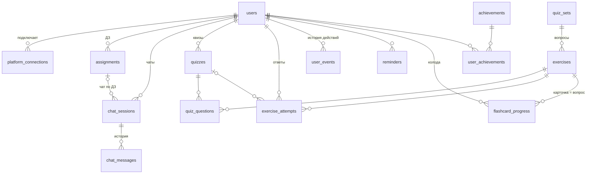

# База данных LekseRadar (PostgreSQL 16)

Хранит всё, что Python-сервисы не хранят: пользователей, собранные ДЗ, историю ИИ-чата,
упражнения и квизы, историю действий, прогресс, напоминания и ачивки. Флеш-карты — это вопросы квизов в режиме повторения, отдельной сущности для них нет.
Работает с ней Java API (Spring Boot).

## Запуск

```
cd database
docker compose up -d        # Postgres на localhost:5432, база/логин/пароль: lekseradar
```

При первом старте применяются все миграции и `seed.sql` (демо-ученик `demo@lekseradar.no`, пароль `demo1234`).
Сбросить: `docker compose down -v && docker compose up -d`.

В Spring Boot: скопировать `migrations/*.sql` в `src/main/resources/db/migration/` и включить Flyway.
Имена `V1__...sql` уже в его формате.

## Миграции

| Файл | Что внутри |
|------|-----------|
| `V1__users.sql` | `users` |
| `V2__homework.sql` | `platform_connections`, `assignments`: подключённые платформы и ДЗ из `homework-collector` |
| `V3__chat.sql` | `chat_sessions`, `chat_messages`, вид `chat_context` (последние 10 реплик для тьютора) |
| `V4__exercises_quizzes.sql` | `exercises`, `quizzes`, `quiz_questions`, `exercise_attempts`, функция `finish_quiz()` |
| `V5__history_progress.sql` | `user_events` (история пользователя), виды `user_topic_progress`, `user_daily_activity`, `user_dashboard` |
| `V6__reminders_achievements.sql` | `reminders`, `achievements`, `user_achievements` |
| `V7__subjects_quiz_sets.sql` | `subjects`, `quiz_sets`: сохранённые квизы от ИИ; новые поля у `exercises` и `quizzes` |
| `V8__quiz_functions.sql` | `find_quiz_set()`, `import_quiz_json()`, `start_quiz()`, `save_quiz_answer()`, виды `quiz_questions_public`, `user_quiz_progress` |
| `V9__flashcards_from_quizzes.sql` | `flashcard_progress`, вид `flashcards`, `add_quiz_set_to_flashcards()`, `review_flashcard()`, ошибка в квизе → карточка |

## Схема



## Основные сценарии (SQL для Java)

**Синхронизация ДЗ.** Результат `collect()` записывается upsert'ом, `updated_credentials` заменяют
`platform_connections.credentials_enc`:
```sql
INSERT INTO assignments (user_id, source, external_id, title, course, due_at, status, url, description, kind, is_demo)
VALUES (?, ?::platform, ?, ?, ?, ?, ?::assignment_status, ?, ?, ?, ?)
ON CONFLICT (user_id, source, external_id) DO UPDATE
SET title = EXCLUDED.title, course = EXCLUDED.course, due_at = EXCLUDED.due_at, status = EXCLUDED.status,
    url = EXCLUDED.url, description = EXCLUDED.description, updated_at = now();
```

**ИИ-чат.** Сохранить реплику студента, взять историю для `TutorRequest.history`, сохранить ответ тьютора:
```sql
INSERT INTO chat_messages (session_id, role, content) VALUES (?, 'student', ?);
SELECT role, content FROM chat_context WHERE session_id = ? ORDER BY created_at;   -- до 10 реплик
INSERT INTO chat_messages (session_id, role, content, on_topic, model) VALUES (?, 'tutor', ?, ?, ?);
```
Список чатов пользователя: `SELECT * FROM chat_sessions WHERE user_id = ? ORDER BY updated_at DESC`
(новое сообщение само поднимает чат наверх).

**Квиз из JSON от ИИ.** Пользователь выбирает предмет, тему и уровень. ИИ генерирует квиз один раз
и отдаёт JSON в формате [`quiz/quiz.schema.json`](quiz/quiz.schema.json) (пример: [`quiz/example.json`](quiz/example.json)).
База хранит его, и в следующий раз тот же квиз берётся из базы, без новой генерации:
```sql
-- 1. Есть ли готовый квиз? (регистр и лишние пробелы не важны)
SELECT find_quiz_set('Matematikk', 'Lineære funksjoner', 'beginner', 'nb');   -- id или NULL
-- 2. Если NULL: ИИ генерирует JSON → импорт (тот же JSON второй раз вернёт тот же id, без дубля)
SELECT import_quiz_json(?::jsonb, :user_id);                                   -- id набора
-- 3. Начать или продолжить незаконченный квиз этого набора
SELECT start_quiz(:user_id, :set_id);                                           -- id квиза
SELECT * FROM quiz_questions_public WHERE quiz_id = ? ORDER BY position;       -- вопросы без ответов
SELECT current_position FROM quizzes WHERE id = ?;                              -- где остановился
-- 4. Ответ: выбор проверяется в базе сам; для text передай вердикт проверки ИИ
SELECT * FROM save_quiz_answer(:quiz_id, 1, '-4');
SELECT * FROM save_quiz_answer(:quiz_id, 3, '["y = -2x + 5","y = -x"]');        -- multiple_choice
SELECT * FROM save_quiz_answer(:quiz_id, 4, 'текст ответа', 'partial', 'пояснение от ИИ');
-- 5. Итог: балл 0–100 (последний ответ на каждый вопрос, partial = 0,5)
SELECT finish_quiz(:quiz_id);
```
Импорт файла вручную:
```
psql -d lekseradar <<'SQL'
\set j `cat quiz/example.json`
SELECT import_quiz_json(:'j'::jsonb);
SQL
```
В Java: прочитать файл в строку и передать параметром. Неверный JSON (нет полей, неизвестный `type`,
правильный ответ не из `options`) отклоняется с понятной ошибкой `quiz json: ...`.

Прогресс по квизам: `SELECT * FROM user_quiz_progress WHERE user_id = ?` (по предмету и теме: пройдено,
в процессе, лучший и последний балл).

**Флеш-карты = тот же квиз.** Карточка — это вопрос квиза: лицевая сторона `statement`, обратная — правильный
ответ и `explanation`. Один JSON от ИИ даёт сразу и квиз, и колоду, ничего не генерируется дважды.
Хранится только прогресс повторения (`flashcard_progress`, алгоритм SM-2).
```sql
SELECT add_quiz_set_to_flashcards(:user_id, :set_id);            -- весь квиз в колоду
SELECT * FROM flashcards WHERE user_id = ? AND due ORDER BY next_review_at;   -- что повторять сейчас
SELECT * FROM review_flashcard(:user_id, :exercise_id, 4);       -- оценка 0–5 → следующий показ
SELECT * FROM user_flashcard_stats WHERE user_id = ?;            -- всего, к повторению, выучено
```
Неверный или частичный ответ в квизе сам добавляет вопрос в колоду с показом «сейчас».

**Прогресс и дашборд.**
```sql
SELECT * FROM user_dashboard WHERE user_id = ?;            -- ДЗ, квизы, средний балл, активные дни
SELECT * FROM user_topic_progress WHERE user_id = ?;       -- освоение по темам, %
SELECT * FROM user_daily_activity WHERE user_id = ? ORDER BY day;
```

**История пользователя.** Каждое действие пишется в `user_events` (`type`, ссылка на строку, `payload`).
Лента: `SELECT * FROM user_events WHERE user_id = ? ORDER BY created_at DESC LIMIT 50`.

**Напоминания.** К отправке: `SELECT * FROM reminders WHERE sent_at IS NULL AND remind_at <= now()`.

## Безопасность

- Пароли только в виде bcrypt-хеша (`password_hash`).
- Токены и cookie платформ шифрует Java перед записью в `credentials_enc` (например AES-GCM с ключом из `.env`).
- Python API получает историю чата без персональных данных: только `role` и `content`.
