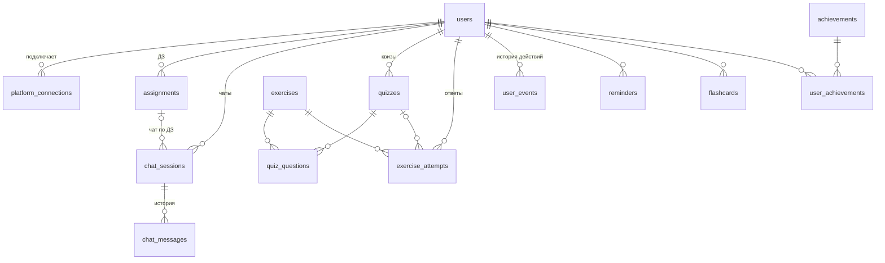

# База данных LekseRadar (PostgreSQL 16)

Хранит всё, что Python-сервисы не хранят: пользователей, собранные ДЗ, историю ИИ-чата,
упражнения и квизы, историю действий, прогресс, напоминания, флеш-карты и ачивки.
Работает с ней Java API (Spring Boot).

## Запуск

```
cd database
docker compose up -d        # Postgres на localhost:5432, база/логин/пароль: lekseradar
```

При первом старте применяются все миграции и `seed.sql` (демо-ученик `demo@lekseradar.no`, пароль `demo1234`).
Сбросить: `docker compose down -v && docker compose up -d`.

В Spring Boot: скопировать `migrations/*.sql` в `src/main/resources/db/migration/` и включить Flyway.
Имена `V1__...sql` уже в его формате.

## Миграции

| Файл | Что внутри |
|------|-----------|
| `V1__users.sql` | `users` |
| `V2__homework.sql` | `platform_connections`, `assignments`: подключённые платформы и ДЗ из `homework-collector` |
| `V3__chat.sql` | `chat_sessions`, `chat_messages`, вид `chat_context` (последние 10 реплик для тьютора) |
| `V4__exercises_quizzes.sql` | `exercises`, `quizzes`, `quiz_questions`, `exercise_attempts`, функция `finish_quiz()` |
| `V5__history_progress.sql` | `user_events` (история пользователя), виды `user_topic_progress`, `user_daily_activity`, `user_dashboard` |
| `V6__reminders_flashcards_achievements.sql` | `reminders`, `flashcards`, `achievements`, `user_achievements` |

## Схема



## Основные сценарии (SQL для Java)

**Синхронизация ДЗ.** Результат `collect()` записывается upsert'ом, `updated_credentials` заменяют
`platform_connections.credentials_enc`:
```sql
INSERT INTO assignments (user_id, source, external_id, title, course, due_at, status, url, description, kind, is_demo)
VALUES (?, ?::platform, ?, ?, ?, ?, ?::assignment_status, ?, ?, ?, ?)
ON CONFLICT (user_id, source, external_id) DO UPDATE
SET title = EXCLUDED.title, course = EXCLUDED.course, due_at = EXCLUDED.due_at, status = EXCLUDED.status,
    url = EXCLUDED.url, description = EXCLUDED.description, updated_at = now();
```

**ИИ-чат.** Сохранить реплику студента, взять историю для `TutorRequest.history`, сохранить ответ тьютора:
```sql
INSERT INTO chat_messages (session_id, role, content) VALUES (?, 'student', ?);
SELECT role, content FROM chat_context WHERE session_id = ? ORDER BY created_at;   -- до 10 реплик
INSERT INTO chat_messages (session_id, role, content, on_topic, model) VALUES (?, 'tutor', ?, ?, ?);
```
Список чатов пользователя: `SELECT * FROM chat_sessions WHERE user_id = ? ORDER BY updated_at DESC`
(новое сообщение само поднимает чат наверх).

**Квиз.** Упражнения от генератора → `exercises`, квиз → `quizzes` + `quiz_questions`,
каждый ответ и `CheckResult` → `exercise_attempts` с `quiz_id`. В конце `SELECT finish_quiz(?)`:
ставит балл 0–100 (последний ответ на каждый вопрос, partial = 0,5) и статус `completed`.

**Прогресс и дашборд.**
```sql
SELECT * FROM user_dashboard WHERE user_id = ?;            -- ДЗ, квизы, средний балл, активные дни
SELECT * FROM user_topic_progress WHERE user_id = ?;       -- освоение по темам, %
SELECT * FROM user_daily_activity WHERE user_id = ? ORDER BY day;
```

**История пользователя.** Каждое действие пишется в `user_events` (`type`, ссылка на строку, `payload`).
Лента: `SELECT * FROM user_events WHERE user_id = ? ORDER BY created_at DESC LIMIT 50`.

**Напоминания.** К отправке: `SELECT * FROM reminders WHERE sent_at IS NULL AND remind_at <= now()`.

## Безопасность

- Пароли только в виде bcrypt-хеша (`password_hash`).
- Токены и cookie платформ шифрует Java перед записью в `credentials_enc` (например AES-GCM с ключом из `.env`).
- Python API получает историю чата без персональных данных: только `role` и `content`.
