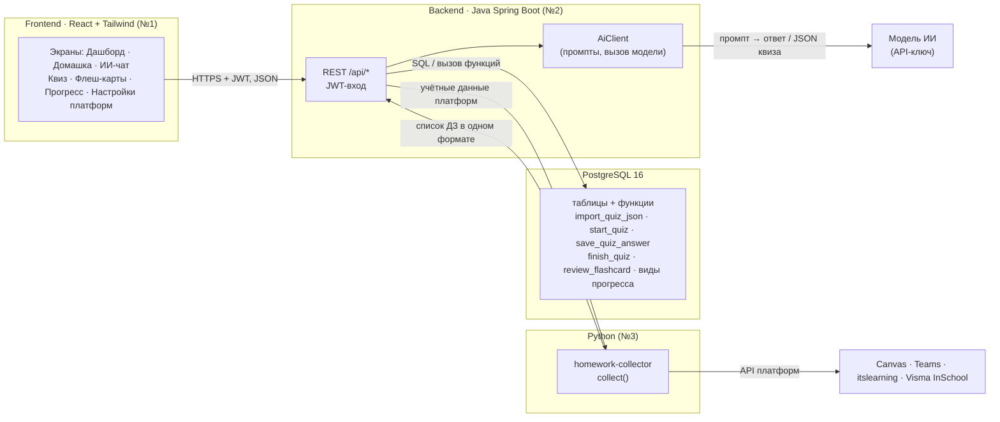
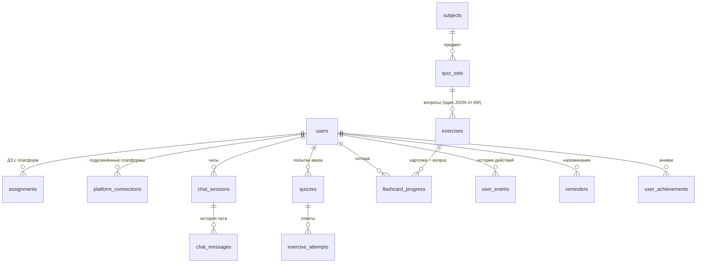

# LekseRadar: как всё работает

Документ для всей команды: кто что делает, как данные ходят между частями и почему сделано именно так.
Подробности по базе: [`database/README.md`](../database/README.md), по сбору ДЗ: [`homework-collector/README.md`](../homework-collector/README.md).

## 1. Общая схема

**Главное правило:** фронт разговаривает только с бэкендом. Бэкенд единственный, кто пишет в базу,
зовёт модель ИИ и сервис сбора ДЗ. Python ничего не хранит.

## 2. Кто за что отвечает

| Часть | Владелец | Отвечает за | Не делает |
|-------|----------|-------------|-----------|
| Frontend | №1 | экраны, состояние интерфейса, вызовы `/api/*` | не ходит в базу, ИИ и платформы напрямую |
| Backend | №2 | вход (JWT), REST API, вызов ИИ, шифрование токенов платформ, вызов функций БД | не дублирует логику квизов/карточек: она в функциях БД |
| База | №2 + №3 | схема, миграции Flyway, функции квизов, карточек и прогресса | — |
| Python | №3 | `collect()` сбор ДЗ с 4 платформ, промпты и формат JSON квиза | не хранит данные |

## 3. Данные коротко

