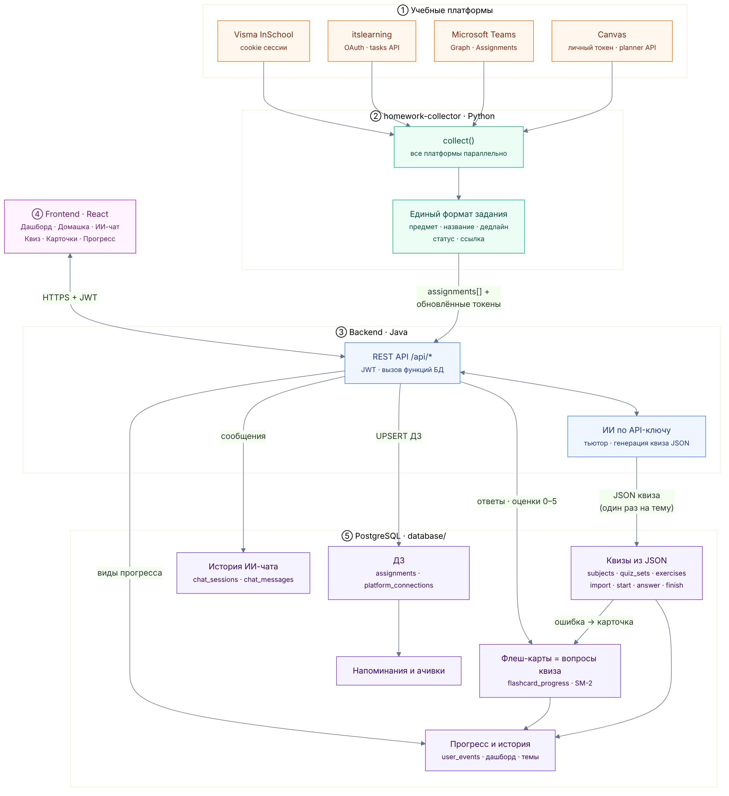
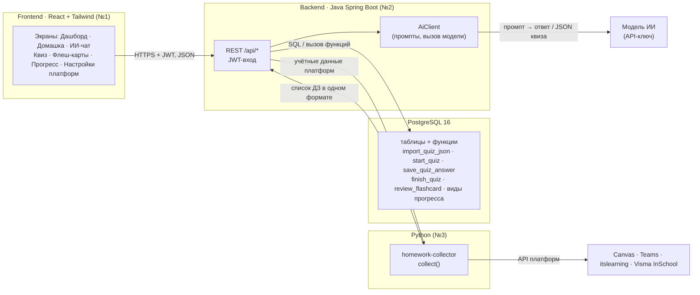
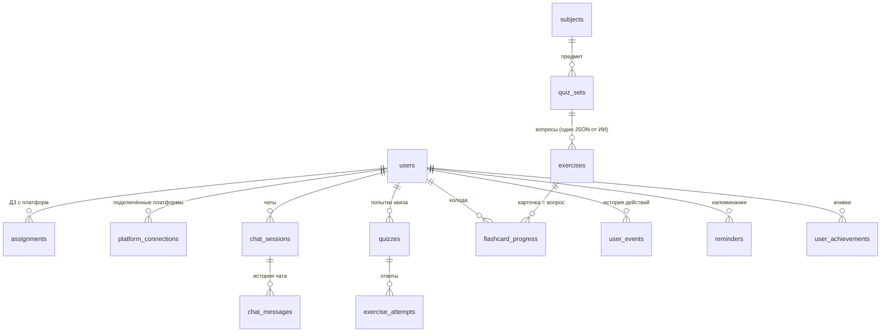
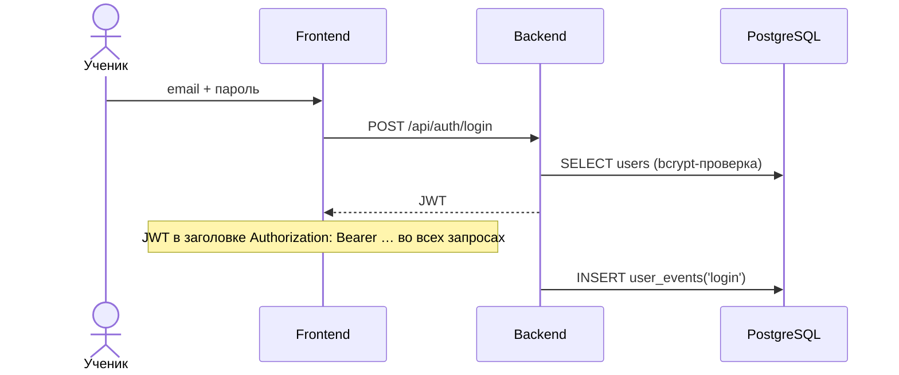
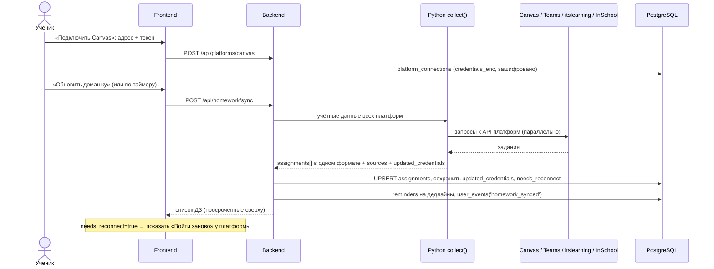
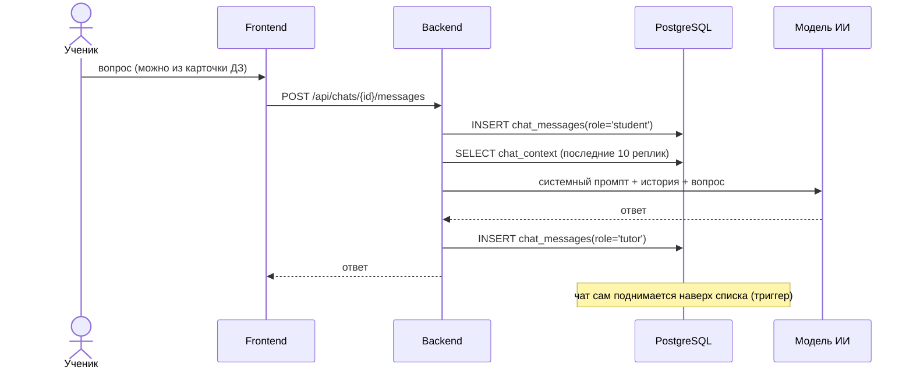
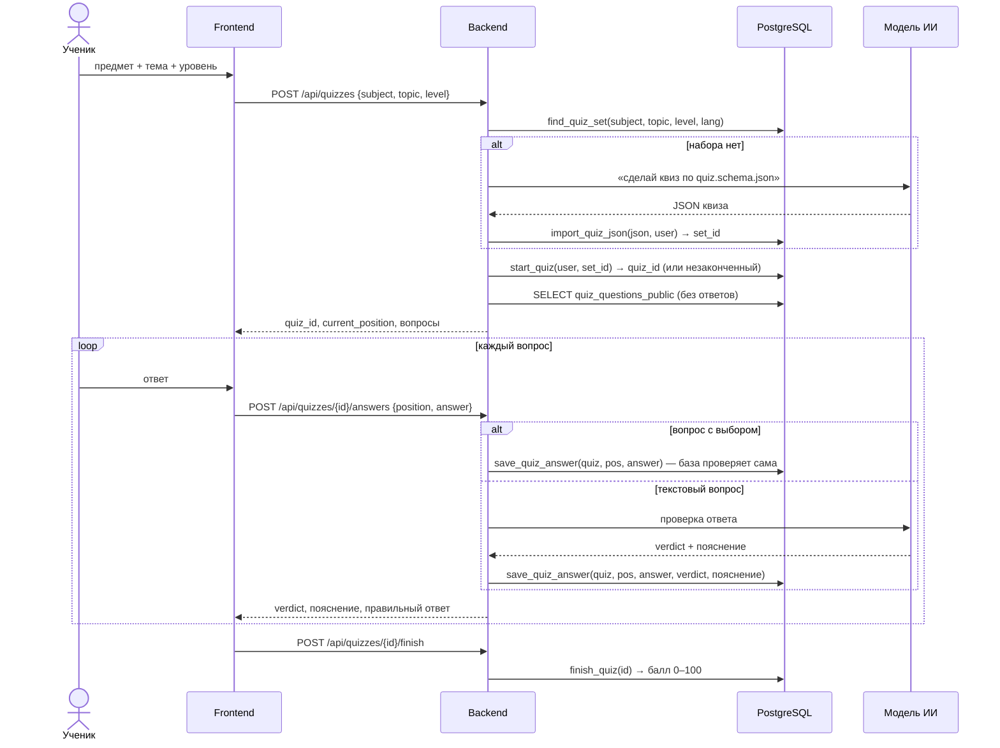
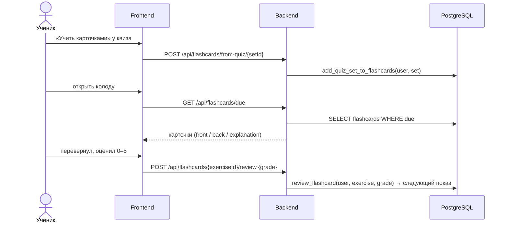
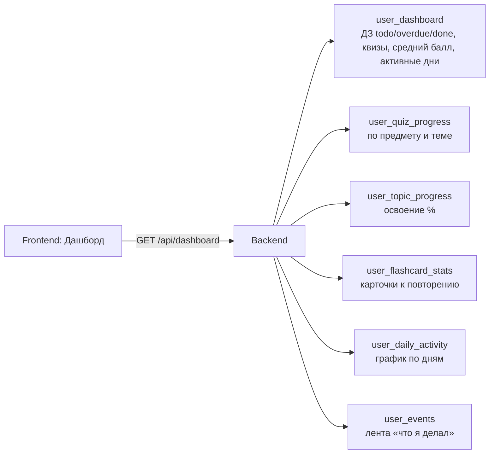

# LekseRadar: как всё работает

Документ для всей команды: кто что делает, как данные ходят между частями и почему сделано именно так.
Подробности по базе: [`database/README.md`](../database/README.md), по сбору ДЗ: [`homework-collector/README.md`](../homework-collector/README.md).

## 1. Общая схема

_Картинка: `docs/schema.png`, исходник: `docs/schema.mmd` (пересобрать: `npx @mermaid-js/mermaid-cli -i docs/schema.mmd -o docs/schema.png -s 2`)._

То же самое подробнее:

**Главное правило:** фронт разговаривает только с бэкендом. Бэкенд единственный, кто пишет в базу,
зовёт модель ИИ и сервис сбора ДЗ. Python ничего не хранит.

## 2. Кто за что отвечает

| Часть | Владелец | Отвечает за | Не делает |
|-------|----------|-------------|-----------|
| Frontend | №1 | экраны, состояние интерфейса, вызовы `/api/*` | не ходит в базу, ИИ и платформы напрямую |
| Backend | №2 | вход (JWT), REST API, вызов ИИ, шифрование токенов платформ, вызов функций БД | не дублирует логику квизов/карточек: она в функциях БД |
| База | №2 + №3 | схема, миграции Flyway, функции квизов, карточек и прогресса | — |
| Python | №3 | `collect()` сбор ДЗ с 4 платформ, промпты и формат JSON квиза | не хранит данные |

## 3. Данные коротко

## 4. Сценарии по шагам

### 4.1 Вход

### 4.2 Подключение платформы и сбор ДЗ

Без подключённых платформ `collect(demo=True)` отдаёт демо-ДЗ: удобно для показа.

### 4.3 ИИ-чат с историей

### 4.4 Квиз: ИИ генерирует один раз, дальше из базы

Ошибочные ответы сами попадают в флеш-карты (триггер), прогресс считается видами.

### 4.5 Флеш-карты (тот же квиз в режиме повторения)

### 4.6 Дашборд, прогресс, история

## 5. API для фронта (Backend → React)

✅ уже есть в PR #2 (JavaAPI-setup) · 🆕 нужно добавить. Все запросы, кроме входа, с `Authorization: Bearer <JWT>`.

| Метод и путь | Экран | Что делает бэкенд | В базе |
|--------------|-------|-------------------|--------|
| ✅ `POST /api/auth/register`, `/login` | Вход | создать пользователя / выдать JWT | `users` |
| ✅ `GET/PUT /api/users/me` | Профиль | профиль | `users` |
| ✅ `GET/POST /api/chats`, `PATCH/DELETE /api/chats/{id}` | ИИ-чат | список и управление чатами | `chat_sessions` |
| ✅ `GET/POST /api/chats/{id}/messages` | ИИ-чат | история / новое сообщение → ИИ | `chat_messages`, `chat_context` |
| 🆕 `GET /api/platforms`, `POST/DELETE /api/platforms/{platform}` | Настройки | подключить платформу, статус, «войти заново» | `platform_connections` |
| 🆕 `POST /api/homework/sync`, `GET /api/homework` | Домашка | вызвать `collect()`, сохранить и отдать ДЗ | `assignments` |
| 🆕 `GET /api/subjects` | Квиз | предметы для выбора | `subjects` |
| 🆕 `POST /api/quizzes` `{subject, topic, level}` | Квиз | найти или сгенерировать, начать | `find_quiz_set`, `import_quiz_json`, `start_quiz` |
| 🆕 `GET /api/quizzes/{id}` | Квиз | вопросы без ответов + где остановился | `quiz_questions_public`, `quizzes.current_position` |
| 🆕 `POST /api/quizzes/{id}/answers` `{position, answer}` | Квиз | проверить и сохранить ответ | `save_quiz_answer` |
| 🆕 `POST /api/quizzes/{id}/finish` | Квиз | итоговый балл | `finish_quiz` |
| 🆕 `POST /api/flashcards/from-quiz/{setId}` | Карточки | добавить квиз в колоду | `add_quiz_set_to_flashcards` |
| 🆕 `GET /api/flashcards/due` | Карточки | что повторять сейчас | вид `flashcards` |
| 🆕 `POST /api/flashcards/{exerciseId}/review` `{grade}` | Карточки | оценка 0–5 | `review_flashcard` |
| ✅ `GET /api/progress` → 🆕 `GET /api/dashboard` | Дашборд | сводка и графики | виды `user_*` |
| 🆕 `GET /api/history` | История | лента действий | `user_events` |
| 🆕 `GET /api/reminders` | Напоминания | ближайшие дедлайны | `reminders` |

В PR #2 уже есть `POST /api/exercises/generate` и `/answer`. Квизы из JSON их заменяют:
генерация один раз на тему, повторное использование, автопроверка вариантов, прогресс и карточки.

## 6. Почему сделано так

| Решение | Почему |
|---------|--------|
| ИИ отдаёт квиз JSON-файлом по схеме `quiz.schema.json` | ответ ИИ проверяется до записи; один и тот же квиз берётся из базы, а не генерируется заново (дешевле и быстрее) |
| Флеш-карта = вопрос квиза | один JSON даёт и квиз, и карточки; не нужно генерировать и хранить одно и то же дважды |
| Логика квиза и карточек в функциях PostgreSQL | бэкенду достаточно вызвать функцию; правила одни для всех, их легко проверить SQL-запросом |
| Ошибка в квизе → карточка автоматически | ученик повторяет именно то, что не знает |
| Python `collect()` без своей базы | бэкенд хранит токены зашифрованными, Python только забирает ДЗ; одна упавшая платформа не ломает остальные |
| `updated_credentials` в ответе `collect()` | токены Teams/itslearning и cookie InSchool обновляются, бэкенд сохраняет новые |
| `user_events` для всего | из одной таблицы строятся история, активные дни, ачивки |
| Демо-режим и `seed.sql` | демо на хакатоне работает без настоящих аккаунтов |

## 7. Что надо согласовать (важно)

1. **Одна схема базы.** В PR #2 своя миграция `backend/.../db/migration/V1__init.sql`
   (`users`, `chat_sessions`, `chat_messages`, `exercises`, `exercise_attempts`) и `ddl-auto: validate`.
   В `database/migrations` те же таблицы, но шире. Вдвоём они не запустятся (две V1).
   Предложение: бэкенд берёт `database/migrations/*` вместо своей V1 и подгоняет JPA-сущности под эти таблицы.
2. **Как бэкенд вызывает `collect()`.** Python-функция; проще всего тонкая обёртка FastAPI `POST /collect`
   или запуск `python -m homework --creds file --json`. Выбирает №2.
3. **Язык промптов и квизов** (`language` в JSON: `nb`, `en`, `ru`).

## 8. Порядок работы

1. №2: перейти на миграции из `database/`, запустить `docker compose up -d` (там демо-ученик `demo@lekseradar.no` / `demo1234`).
2. №2: эндпоинты квиза и карточек (п. 5) — это вызовы готовых функций БД.
3. №1: экраны Квиз и Карточки по сценариям 4.4 и 4.5, дашборд по 4.6.
4. №3: промпт генерации квиза под `quiz.schema.json`, обёртка для `collect()`.
5. ДЗ с платформ подключаем последними, до этого демо-режим.
